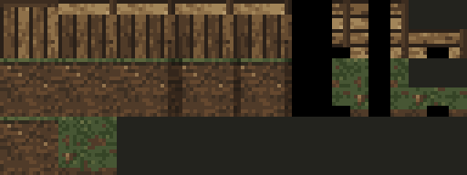

# Земляные обрывы, проходы и слабые тропы

Дата: 2026-11-04. Изменения выполнены по четырём указаниям Автора.

За пределами домов стены Залесья и Лесной тропы выглядят как крутой
земляной обрыв с корнями и дёрном. Стены домов и амбара остаются деревянными.
Столкновения и обзор по-прежнему определяются обычным `Terrain.WALL`:
на обрыв нельзя зайти. Деревья и планировка карт сохранены.

## Генерация и файлы

Использован встроенный `image_gen`, два независимых вызова: земляная
лицевая поверхность и верх из дёрна. Референсы — прежний набор поверхности
и её травяной тайл. Полные промпты и параметры — в
[earth-cliffs-prompts.json](earth-cliffs-prompts.json), исходные результаты —
[generated/earth-cliffs/face.png](generated/earth-cliffs/face.png) и
[cap.png](generated/earth-cliffs/cap.png).

Материалы уменьшены точечной выборкой до 16×16 и приведены к сдержанной
земляной и зелёной палитре. [Скрипт упаковки](build-earth-cliffs.ps1) использует
прежние силуэты, альфа-канал и чёрные внутренние области 34 вариантов стен.

| Файл относительно `core/src/main/assets/environment/` | Назначение |
| --- | --- |
| [surface_earth_wall_face.png](../../core/src/main/assets/environment/surface_earth_wall_face.png) | Грунт, корни и тонкая кромка травы, 16×16. |
| [surface_earth_wall_cap.png](../../core/src/main/assets/environment/surface_earth_wall_cap.png) | Верх обрыва из дёрна, 16×16. |
| [tiles_surface_cliffs.png](../../core/src/main/assets/environment/tiles_surface_cliffs.png) | Производный набор 256×576. Первые 320 слотов совпадают с прежним набором; смещение земляных вариантов — 320. |

Исходный `tiles_surface.png` не менялся: все его 81 920 пикселей совпадают
с первыми 320 строками нового набора. Контрольный исходник сохранён в
[tiles-surface-before.png](generated/earth-cliffs/tiles-surface-before.png).
`OutdoorLevel.tilesTex()` подключает новый набор. `SurfaceCliffTiles`
перенаправляет нижний и верхний слои наружных стен в земляные слоты;
`isHouseCell()` исключает прямоугольники зданий, включая углы и дверные стены.
Нависающий край использует материал стены под ним, а не пола под краем.

## Переходы

После добавления лесных коридоров триггер в Залесье занимает (28–29, 39–40),
в лесу — (10–11, 1–2). См. [последующее расширение карт](forest-passages.md).
Точки прибытия отделены от них:

| Направление | Точка прибытия |
| --- | --- |
| Из Залесья в Лесную тропу | (10, 4), ниже северного триггера. |
| Из Лесной тропы в Залесье | (28, 37), выше южного триггера. |

`InterlevelScene` запрашивает `Level.transitionArrivalCell()`. Поверхность
выбирает отдельную точку для `SECTION`; лестницы используют прежнюю точку.
Точка находится на две клетки вглубь карты от ближайшей границы триггера.
Требуемый результат — после перехода обычное движение с клавиатуры
не запускает немедленный возврат из-за появления на активном триггере.
Проверка поведения в игре оставлена Автору.

На внешней строке карты в створе прохода вместо рисунка стены — чёрный
просвет. Нависающая часть перед ним также скрыта. Непроходимая внешняя
строка сохранена для безопасной индексации карты; переход срабатывает
на обычной тропе перед ней. Это визуальное оформление, без новой пропасти
или механики падения.

## Тропинки

От колодца к южному проходу проложена слабая ветвящаяся тропа вдоль поля.
На лесной карте ослаблены все тропинки; добавлены короткие ответвления
к опушке, двору и лугу. `TRAIL_WEAR` задаёт постоянные травяные разрывы
в угловых масках, а `FAINT_ROUTES` и маршруты `WoodlandFloorTiles` —
авторское направление ветвей. Случайных чисел нет. Прежние тайлы переходов
между травой и землёй сохранены; покрытие остаётся декоративным.

[Залесье](surface-paths-layout.png), [Лесная тропа](woodland-preview.png).
Это статические схемы с плоскими стенами, без освещения и тумана войны.
Обновление оформления и точек прибытия применяется после загрузки карт
с уже существующим южным проходом. Последующее увеличение размеров
и добавление лесных коридоров требуют новой игры, миграции нет.

## Проверка

Просмотрены материалы, варианты стен, статические схемы, исходники и diff.
Проверено совпадение всех прежних пикселей набора поверхности.
`:core:compileJava` и `:android:assembleDebug` успешны. После `adb devices -l`
APK установлен обновлением на Wi-Fi планшет с явным serial
`adb-eb278ce2-Gf1NFr._adb-tls-connect._tcp` (`Success`). Подтверждены пакет
`com.shatteredpixel.shatteredpixeldungeon.indev`, версия `4.0.2-INDEV` (922)
и время обновления `2026-11-04 17:04:05`. Новый набор, оба материала,
прежний набор поверхности, атласы экстерьера и мебели и PNG колоды —
все семь проверенных ресурсов в APK совпадают с исходниками по SHA-256.
Игра, автотесты и игровые сценарии не запускались.
