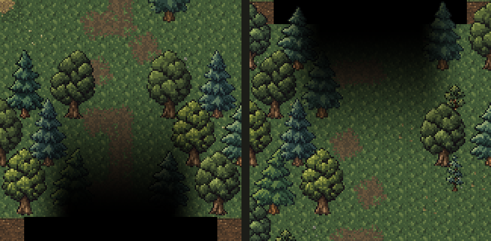

# Видимые проходы через лес

Дата: 2026-11-04. По просьбе Автора обе карты немного увеличены по вертикали,
чтобы перед тёмным краем был виден проход между деревьями.

Это статические фрагменты из игровых ресурсов, без запуска игры, освещения
и тумана войны. [Скрипт сравнения](render-forest-passages.ps1),
[полное Залесье](surface-paths-layout.png), [Лесная тропа](woodland-preview.png).

| Локация | Прежний размер | Новый размер | Изменение |
| --- | --- | --- | --- |
| Залесье | 56×38 | 56×42 | Четыре ряда снизу: деревья по бокам продолженной тропы. |
| Лесная тропа | 28×36 | 28×40 | Четыре ряда сверху: лесной коридор перед прежней опушкой. |

В Залесье дома, NPC, колодец, поле и стога не перемещались.
Начало координат покрытия закреплено в прежнем (28, 19), поэтому увеличение
высоты не сдвигает поле и декоративные пятна относительно объектов.
Два добавленных ряда схемы `SurfaceForest.PLAN` обрамляют проход к югу.

В Лесной тропе два ряда лесной схемы добавлены перед прежними, поэтому
домик, двор, отдельные деревья, покрытие луга и ветви тропы сдвинуты вниз
ровно на четыре клетки. Расстановка относительно друг друга сохранена.
Дом теперь начинается в (16, 12), дверь — (19, 18), колода с топором — (18, 23).
Сдвиг на два ряда схемы сохраняет прежнее чередование горизонтальных смещений деревьев.

По последующему уточнению Автора конец коридора плавно затемняется
программным градиентом поверх тропы и деревьев. В створе прохода стены
и нависающие части скрыты с боковым запасом. Новых игровых текстур нет;
см. [плавное затемнение](passage-fade.md). Земляные стены,
деревянные здания, прежние спрайты и слабые ветвящиеся дорожки сохранены.

| Локация | Зона триггера | Центр триггера | Точка прибытия |
| --- | --- | --- | --- |
| Залесье | (28–29, 39–40) | (28, 40) | (28, 37) |
| Лесная тропа | (10–11, 1–2) | (10, 1) | (10, 4) |

Прибытие остаётся вне зоны перехода. Южный триггер и его точка прибытия
вычисляются относительно высоты карты. Размеры и лес сохраняются в уровне,
поэтому для новых коридоров требуется новая игра; старые карты не перестраиваются,
миграция не добавлялась.

Просмотрены обе статические схемы, фрагменты проходов, размещение и diff.
Схемы имеют одинаковую длину строк: Залесье — 27×20 символов,
лесная локация — 13×19. `:core:compileJava` и `:android:assembleDebug` успешны.
После `adb devices -l` APK установлен обновлением на Wi-Fi планшет с явным
serial `adb-eb278ce2-Gf1NFr._adb-tls-connect._tcp` (`Success`). Подтверждены
пакет `com.shatteredpixel.shatteredpixeldungeon.indev`, версия `4.0.2-INDEV`
(922) и время обновления `2026-11-04 17:20:37`.
Игра, автотесты и игровые сценарии не запускались.
