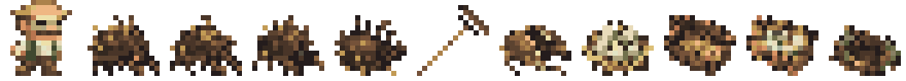

# Квест «Кто-то дышит в сене»

Дата: 2026-11-02. Квест утверждён Автором и реализован в стартовой деревне.

## Содержание

Мирон просит проверить сопение в двух стогах и обещает 30 монет. После
согласия выдаёт деревянные грабли. У ближнего стога лежит перегрызенная
верёвка; разбор его края открывает пустой панцирь. Находка необязательна
для продолжения: второй стог можно исследовать первым.

Первое действие у второго стога открывает лапы и предупреждает об опасности.
Следующее выпускает одного сеногрыза. Жук заранее намечает клетку броска,
скребёт землю и меняет позу; клетка отмечается красным. Следующим действием
он движется по намеченной линии до трёх клеток, останавливаясь перед
препятствием или существом. После броска пропускает ход, разворачиваясь.
Положение цели и восстановление сохраняются. Базовые характеристики:
18 здоровья, 4 урона до защиты героя, 1 защиты (0 при восстановлении),
4 опыта. Бросок имеет гарантированную точность, если герой остался на линии;
прочие эффекты и защита используют существующий боевой код. Случайного
дропа и случайного блуждания в обычном преследовании нет.

После гибели жука разбор сена открывает пять яиц. Кладку можно уничтожить
с подтверждением либо оставить. Мирон предлагает перенос и выдаёт пустой
короб. Яйца укладываются в него у стога, затем герой оставляет короб
в сухой выемке у опушки. Оба исхода дают ровно 30 монет при возвращении
к Мирону; грабли и оставшийся пустой короб в рюкзаке возвращаются.
После переноса при следующей загрузке поверхности короб показывается
пустым, рядом появляются маленькие следы. Новые живые противники из кладки
не создаются.

Журнал содержит отдельные стадии расследования, решения о кладке,
переноса и возвращения за платой. После награды запись удаляется.
Русские и английские диалоги дают художественные подсказки; журнал
не перечисляет действия интерфейса.

## Размещение

Координаты от нуля, поверхность 72×52; стоги сохраняют прежнее положение.

| Объект | Клетка |
| --- | --- |
| Мирон | (47, 28) |
| Первый стог | основания (49–50, 29) |
| Верёвка и найденный панцирь | (48, 30), (49, 30) |
| Второй стог | основания (54–55, 31) |
| Выход сеногрыза | (55, 32) |
| Кладка после разбора сена | (54, 32) |
| Укрытие и позднейшие следы | (56, 35), (56, 36) |

Сеногрыз всегда появляется в одной заданной клетке. Если её занял герой,
другой персонаж или предмет, действие откладывается с подсказкой.
Напольные находки и укрытие проходимы и пропускают обзор. Свойства стогов
не менялись: основания непроходимы и закрывают обзор.

`SurfaceLevel` сохраняет экземпляр `HayQuest`; статических флагов прохождения
нет. Выданный короб хранит наполнение самостоятельно. Полный рюкзак
не начинает квест без грабель и не расходует право получить короб.
Повторные выдачи предметов, создание жука и награда ограничены флагами.
Выброшенные инструменты можно подобрать обычным способом.

Квест создаётся вместе с новой поверхностью. Посещённая до обновления
поверхность не дополняется: потребуется новое прохождение. Миграции нет.

## Ресурсы



Слева направо: Мирон, четыре кадра сеногрыза, грабли, панцирь, кладка,
пустой и полный короб, укрытие. Это статический просмотр ресурсов,
не игровой скриншот.

Все десять исходных изображений созданы отдельными вызовами встроенного
`image_gen` с настоящей прозрачностью; CLI/API не использовались.
После замечания Автора Мирон отдельно перегенерирован по настоящему кадру
воина и референсам остальных героев: увеличенная широкая голова,
плотный короткий корпус и короткие ноги. Шляпа, усы и рабочая одежда сохранены.
Полные промпты и имена исходных результатов сохранены в
[hay-quest-generation.json](hay-quest-generation.json).
Подготовка из каталога исходных результатов:

```powershell
./docs/art/prepare-hay-quest.ps1 -SourceDirectory '<каталог с результатами image_gen>'
# Только новый Мирон и обновление статического предпросмотра:
./docs/art/prepare-hay-quest.ps1 -SourceDirectory '<каталог с результатами image_gen>' -MironOnly
```

Скрипт использует Windows PowerShell и System.Drawing. Изображения
обрезаются по альфа-каналу ≥128, уменьшаются выборкой ближайшего пикселя
до игровых силуэтов и приводятся к палитре из 27 цветов. Четыре позы жука
вырезаются из отдельных четвертей сгенерированного листа. Сглаживания нет.

- [Мирон](../../core/src/main/assets/sprites/miron.png) — 16×16, один кадр.
  [Сравнение пропорций](miron-style-comparison.png), слева направо:
  настоящий воин, существующий Дровосек, прежний Мирон, новый Мирон.
  [Шаблон воина](miron-warrior-template.png) — настоящий кадр 12×15
  в ячейке 16×16, увеличенной в 32 раза без сглаживания;
  [прежний Мирон](miron-before-reference.png) использован только как
  референс одежды и узнаваемых черт. Дополнительный референс —
  [шесть героев](water-quest-hero-reference.png). Новый спрайт извлечён
  по альфа-каналу и приведён к 12×15 внутри кадра 16×16.
  Остальные игровые PNG при этой переработке не менялись (проверены SHA-256).
  Замена текстуры применяется при загрузке уже существующего Мирона;
  новое прохождение для неё не требуется.
- [Сеногрыз](../../core/src/main/assets/sprites/senogryz.png) — 64×16,
  четыре кадра 16×16: ожидание, ходьба, подготовка, гибель.
- [Отдельные предметы](../../core/src/main/assets/environment/hay-quest/) —
  восемь PNG 16×16: грабли, панцирь, яйца, два состояния короба,
  следы, верёвка и укрытие.
- [Напольный атлас](../../core/src/main/assets/environment/custom_tiles/hay_quest.png) —
  128×16; кадры 0–6: верёвка, панцирь, яйца, пустой короб, полный короб,
  следы, укрытие. Последний кадр пустой.
- В `sprites/items.png` изменены только три свободных слота:
  `QUEST` (464, пустой короб), `QUEST+14` (478, грабли), `QUEST+15`
  (479, полный короб). Кадры целиком 16×16; остальные пиксели сохранены.

## Проверка

Просмотрены итоговые спрайты в увеличении. Проверены размеры и прозрачность
PNG, свободные клетки размещения по статической схеме леса, совпадение
101 нового ключа русской и английской локализаций и отсутствие повторов
среди них. В атласе предметов изменены 258 пикселей внутри трёх выделенных
слотов; вне них изменений нет. Результаты компиляции, сборки и установки
указаны в контексте проекта. Игра, автотесты и игровые сценарии не запускались.
