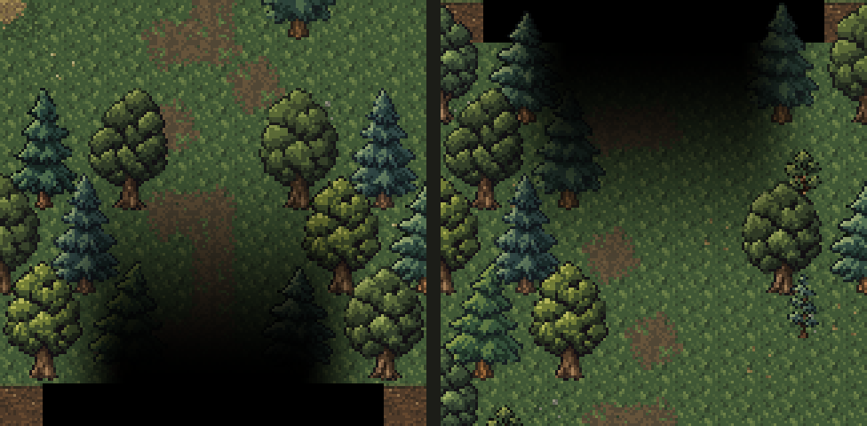

# Плавное затемнение лесных переходов

Дата: 2026-11-04. По уточнению Автора поверх существующей графики наложен
программный градиент: тропа среди деревьев плавно уходит в черноту,
а внешняя стена в створе перехода полностью скрыта. Новые игровые
изображения, текстуры в ресурсах и вызовы `image_gen` не использовались.

Это статическая иллюстрация формулы затемнения поверх схемы из игровых
ресурсов. Она не является скриншотом игры и не проверяет работу OpenGL.
Размеры карт, лесные коридоры, триггеры и точки прибытия сохранены.

## Отрисовка

`effects/PassageFade.java` использует стандартную двухцветную полосу
движка `TextureCache.createGradient()` и статическую сетку квадратов
с шагом четыре игровых пикселя. Прозрачность задаётся координатой
в существующем механизме градиента; собственный шейдер не добавлялся.
Маленькая полоса прозрачного и непрозрачного чёрного создаётся в памяти,
не записывается в PNG и повторно используется через кэш движка.

По следующему уточнению Автора затемнение смягчено: его длина увеличена
с пяти до семи клеток, а боковая кромка — с полутора до двух клеток.
Так эффект становится более протяжённым и пологим, чтобы визуально
отличаться от края обзора. Сам туман войны не менялся.

Затемнение занимает семь клеток от края карты. Внешний ряд полностью
чёрный в центре прохода; на подходе прозрачность плавно стремится к нулю.
По сторонам градиент также плавный: по две клетки мягкой кромки
вокруг центральной части. Непрозрачность задаёт `smoothstep` в обоих
направлениях, поэтому у начала эффекта нет резкой поперечной границы.

`OutdoorLevel.addWallVisuals()` размещает эффект над землёй, персонажами,
стволами, кронами и нависающими частями стен, но ниже тумана войны.
Туман и исследование территории сохраняют прежнюю отрисовку.
Буфер сетки создаётся при первой отрисовке и удаляется вместе с эффектом.

## Скрытие стены

`isPassageMouth()` скрывает внешние стены в створе триггера с запасом
по три клетки по сторонам. `SurfaceCliffTiles` сохраняет под ними чёрный
фон и убирает верхний слой, включая нависающий край перед стеной.
Земляной обрыв не просвечивает в градиенте и не образует порог поперёк тропы.
Внешний ряд физически непроходим, как прежде; переход активируется перед ним.

Изменение касается оформления. Оно восстанавливается из существующих
переходов при создании сцены, не требует нового прохождения или миграции.
Прибытие остаётся в (28, 37) в Залесье и (10, 4) в Лесной тропе,
вне зон триггеров.

## Проверка

Просмотрены порядок слоёв, формула и сетка, освобождение буфера,
статическое превью обоих направлений и diff. Изменений в
`core/src/main/assets` нет. `:core:compileJava` и `:android:assembleDebug` успешны.
После `adb devices -l` APK установлен обновлением на Wi-Fi планшет с явным
serial `adb-eb278ce2-Gf1NFr._adb-tls-connect._tcp` (`Success`). Подтверждены
пакет `com.shatteredpixel.shatteredpixeldungeon.indev`, версия `4.0.2-INDEV`
(922) и время обновления `2026-11-04 17:48:26`.
Игра, автотесты и игровые сценарии не запускались.
