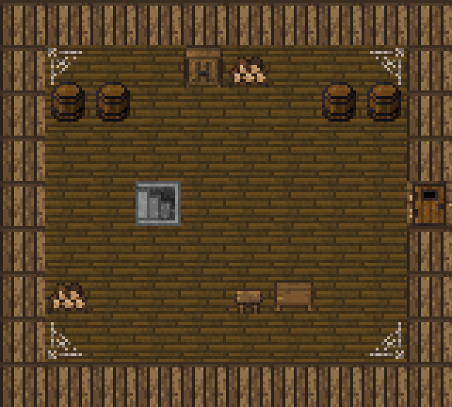
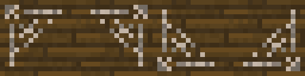

# Заброшенный амбар у выхода из подземелья

Дата: 2026-11-02.

По просьбе Автора выход из подземелья перенесён из середины деревни
в отдельный заброшенный амбар западнее домов. Лестница ведёт в амбар,
а дверь в его правой, восточной стене открывает путь к деревне.



Это схема из игровых ресурсов, созданная без запуска игры. Стены показаны
плоскими тайлами; схема не воспроизводит освещение и нависающие края стен.

## План и готовые ресурсы

`SurfaceLevel.build()` создаёт амбар с левым верхним углом (24, 44)
и размером 10×9 клеток, включая стены. Деревянные стены и дощатый пол
взяты из существующего набора поверхности. Лестница находится в (27, 48),
обычная незапертая дверь — в (33, 48). Центральный проход между ними свободен.
Дома деревни и их обстановка сохраняют своё размещение.

`furnishBarn()` размещает предметы по фиксированному плану:

| Объект | Координаты | Графика |
| --- | --- | --- |
| Четыре бочки | (25, 46), (26, 46), (31, 46), (32, 46) | Бочки оригинала с деревянным полом, `REGION_DECO_ALT`; основание 131, верх 243 в `tiles_surface.png`. |
| Шкаф | (28, 45) | Существующий `SurfaceFurniture.Type.CUPBOARD`. |
| Две поленницы | (29, 45), (25, 50) | Существующий `FIREWOOD`. |
| Рабочий стол | (30, 50) | Существующий `TABLE`. |
| Табурет | (29, 50) | Существующий `STOOL`. |
| Паутина | (25, 45), (32, 45), (25, 51), (32, 51) | Одна новая текстура и три отражения. |

Таким образом, кроме бочек используются четыре вида готовой мебели.
Мебель и бочки непроходимы и пропускают обзор. У мебели признак `abandoned`
выбирает отдельные описания старых, пыльных предметов и сохраняется через
`Bundle`. Названия и описания бочек задаёт `SurfaceLevel`.
Тексты добавлены на русском и английском в `messages/levels/levels*.properties`.

`SurfaceFloorTiles` задаёт небольшой след потёртой травы от восточной двери
к деревне. Новые случайные раскладки или игровые взаимодействия не добавлялись.

## Паутина

Встроенным `image_gen` создан один прозрачный спрайт паутины. CLI и внешние
API не использовались. Готовые файлы:

- [cobweb.png](../../core/src/main/assets/environment/furniture/cobweb.png) — 16×16, прозрачный фон.
- [surface_cobwebs.png](../../core/src/main/assets/environment/custom_tiles/surface_cobwebs.png) — 64×16, четыре угла в порядке северо-западный, северо-восточный, юго-западный, юго-восточный.



Исходный результат: 1254×1254. Границы рисунка найдены по альфа-каналу
с порогом 128: (165, 168, 924, 902). Из центров ячеек этой области выбраны
14×14 пикселей без интерполяции, затем помещены в центр прозрачного PNG 16×16.
Выбранные цвета и альфа-канал сохранены. Три остальных угла получены отражением
по горизонтали, вертикали и обеим осям; новые рисунки для них не генерировались.

`SurfaceCobweb extends CustomTilemap` рисует прозрачное изображение через
`Level.customTiles` поверх обычного `Terrain.EMPTY_SP`. Класс сохраняет
положение и угол через `Bundle`. Паутина декоративная: она не является
игровым `Web`, не обездвиживает героя, не меняет проходимость или обзор.

Точный промпт, `transparent_background: true`:

```text
Use case: stylized-concept. Asset type: one production pixel-art cobweb sprite for an abandoned medieval barn in Shattered Pixel Dungeon. Create ONE small dusty cobweb stretched into the upper left corner of a square tile. Actual transparent background, NO floor or walls. Native resolution exactly 16 by 16 logical pixels, displayed enlarged with solid square pixel blocks. Sparse coarse discrete muted grey-beige silk strands with three radial threads attached along the TOP and LEFT edges and two curved connecting strands. Spiderweb occupies upper-left triangular half of tile; bottom-right mostly transparent. Only about 3 muted warm grey shades. Old dusty neglected barn mood, simple chunky pixel art readable at 16px. No spider, no glow, no gradients, no antialiasing, no text, no watermark, no frame, no cast shadow. A single isolated cobweb with genuine transparent pixels between strands.
```

## Применение и проверка

Новая планировка применяется при создании поверхности. Уже посещённая карта
загружается из сохранения без перестройки; для неё нужно новое прохождение.
Миграция сохранений не добавлялась.

Проверены изменения кода, diff, схема, увеличенные PNG, размеры и прозрачность,
совпадение восьми новых русских и английских ключей. Два новых PNG и обе
локализации в APK совпадают с исходниками по SHA-256; подпись APK проверена.
`:core:compileJava`
и `:android:assembleDebug` выполнены успешно. APK установлен обновлением
на планшет Автора по Wi-Fi ADB с serial `adb-eb278ce2-Gf1NFr._adb-tls-connect._tcp`
(`Success`); пакет `com.shatteredpixel.shatteredpixeldungeon.indev`,
версия `4.0.2-INDEV` подтверждены через ADB. Игра, автотесты и игровые
сценарии не запускались.
