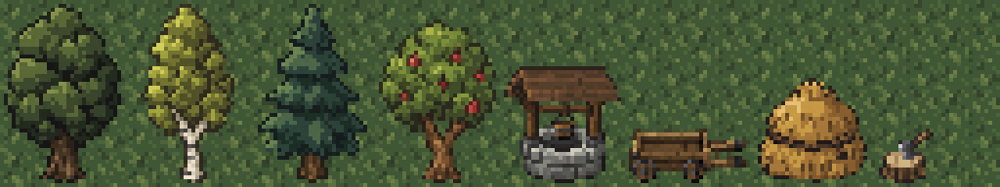

# Экстерьер домов поверхности

Дата: 2026-11-01.

По просьбе Автора встроенным `image_gen` созданы восемь отдельных текстур:
дуб, берёза, сосна, яблоня, колодец, телега, стог сена и колода с топором.
Каждый предмет сгенерирован отдельным вызовом с прозрачным фоном.
CLI и внешние API не использовались.



## Ресурсы

Прозрачные изображения находятся в
[environment/exterior](../../core/src/main/assets/environment/exterior/).
Игровой атлас
[surface_exterior.png](../../core/src/main/assets/environment/custom_tiles/surface_exterior.png)
имеет размер 256×48 пикселей: 16 колонок и три ряда тайлов 16×16.

| Предмет | PNG | Размер | Колонки атласа | Верхний ряд | Наземное основание |
| --- | --- | --- | --- | --- | --- |
| Дуб | [oak.png](../../core/src/main/assets/environment/exterior/oak.png) | 32×48 | 0–1 | 0 | 2×1 |
| Берёза | [birch.png](../../core/src/main/assets/environment/exterior/birch.png) | 32×48 | 2–3 | 0 | 2×1 |
| Сосна | [pine.png](../../core/src/main/assets/environment/exterior/pine.png) | 32×48 | 4–5 | 0 | 2×1 |
| Яблоня | [apple_tree.png](../../core/src/main/assets/environment/exterior/apple_tree.png) | 32×48 | 6–7 | 0 | 2×1 |
| Колодец | [well.png](../../core/src/main/assets/environment/exterior/well.png) | 32×32 | 8–9 | 1 | 2×1 |
| Телега | [handcart.png](../../core/src/main/assets/environment/exterior/handcart.png) | 32×16 | 10–11 | 2 | 2×1 |
| Стог сена | [haystack.png](../../core/src/main/assets/environment/exterior/haystack.png) | 32×32 | 12–13 | 1 | 2×1 |
| Колода с топором | [chopping_block.png](../../core/src/main/assets/environment/exterior/chopping_block.png) | 16×16 | 14 | 2 | 1×1 |

Ряд 2 атласа содержит основания всех предметов. Неиспользуемые области
прозрачные. Трава рисуется обычным слоем поверхности под спрайтами.

## Подготовка изображений

Первый стилевой референс — [одобренный интерьер](surface-furniture-preview.png).
Второй — [подборка исходных объектов и материалов игры](surface-furniture-reference.png).
Оба передавались во все восемь вызовов как референсы, без их изменения.

Из каждого результата взят рисунок по границам альфа-канала с порогом 128.
Рисунок уменьшен выборкой ближайшего исходного пикселя из центра каждой
целевой ячейки, без интерполяции; выбранные цвета и альфа сохранены.
Он выровнен горизонтально по центру с одним прозрачным пикселем снизу.

| Предмет | Исходный размер | Обрезка (x, y, ширина, высота) | Размер рисунка внутри PNG |
| --- | --- | --- | --- |
| Дуб | 1024×1536 | (32, 85, 963, 1384) | 30×46 |
| Берёза | 1024×1536 | (201, 43, 614, 1450) | 24×46 |
| Сосна | 1024×1536 | (112, 57, 801, 1441) | 28×46 |
| Яблоня | 1024×1536 | (39, 195, 946, 1162) | 30×42 |
| Колодец | 1254×1254 | (157, 176, 960, 1019) | 30×30 |
| Телега | 1774×887 | (227, 200, 1391, 561) | 30×14 |
| Стог сена | 1254×1254 | (138, 196, 979, 921) | 28×27 |
| Колода с топором | 1254×1254 | (313, 277, 706, 781) | 14×14 |

## Размещение и поведение

`SurfaceLevel.plantTrees()` и `decorateYards()` используют фиксированные
координаты относительно центра карты. При размере поверхности 100×100
получается следующая схема. Координаты от нуля, указана левая клетка
наземного основания, а не вершина кроны.

| Вид | Координаты оснований |
| --- | --- |
| Дубы | (35, 44), (56, 38), (60, 59), (34, 51) |
| Берёзы | (38, 38), (64, 42), (48, 65) |
| Сосны | (43, 38), (65, 48), (55, 65), (39, 53) |
| Яблони | (48, 40), (59, 52), (41, 61) |
| Колодец | (50, 40) |
| Телеги | (37, 47), (57, 57) |
| Стога сена | (63, 53), (43, 52) |
| Колоды с топорами | (38, 45), (42, 50) |

Всего 14 деревьев и семь дворовых объектов, 40 занятых наземных клеток.
Внутри домов и на дверях новых объектов нет; лестница (50, 50) свободна.
Деревья окружают внешние стороны поселения; дворовые предметы стоят
снаружи возле домов и на северной площадке.

`SurfaceExterior extends CustomTilemap` разделяет рисунок на слои.
Нижний ряд каждого предмета лежит в `Level.customTiles`.
Верхние ряды дерева, колодца и стога лежат в `Level.customWalls`,
поверх персонажей, как нависающие части статуй в исходной игре.
Крона дерева занимает два ряда к северу от основания; крыша колодца
и верх стога — один. Под нависающими частями остаётся травяной пол.

Непрозрачность реализована для наземных оснований:
`Terrain.SURFACE_DECO` (40) имеет `SOLID | LOS_BLOCKING`, без
`PASSABLE`. Все основания блокируют ходьбу. По решению Автора от 2026-11-01
колодец, телега и колода с топором пропускают обычный обзор; деревья и стога
сена его закрывают. `SurfaceExterior.blocksSight()` задаёт это правило,
а `SurfaceLevel.buildFlagMaps()` и `updateCellFlags()` применяют его к
`losBlocking`, сохраняя флаги непроходимости. Обзор пересчитывается и при
загрузке уже созданной поверхности, без нового прохождения.
В `DungeonTileSheet` этому типу назначены обычный пол и стыки с водой
и пропастью. Прозрачный фон PNG сохраняет вид травы за силуэтами.

Тип объекта, признак верхнего слоя и прямоугольник сохраняются
стандартным `Bundle`. При осмотре любой клетки основания показываются
целое изображение предмета, название и описание. Русские и английские
строки: `tiles.surfaceexterior.*` в `messages/levels/levels*.properties`.
Сбор яблок, рубка деревьев, использование колодца и телег не добавлялись.

Объекты появляются при создании поверхности. Уже сохранённая карта
не перестраивается; для ранее посещённой поверхности нужно новое прохождение.

## Промпты

Каждый вызов использовал следующий общий префикс, дополнение своего предмета,
два указанных референса и `transparent_background: true`.

Общий префикс:

```text
Use case: stylized-concept. Asset type: production pixel-art outdoor environmental obstacle for the existing Shattered Pixel Dungeon game. INPUT 1 is STYLE REFERENCE: the approved native-game furniture atlas enlarged 8x. INPUT 2 is STYLE SUPPORT: actual game statue, barrels, wood floor, timber walls and 16px-tall lumberjack enlarged 6x. Create exactly ONE NEW outdoor object, matching the simple low-resolution chunky pixel shapes, soft dark outlines and muted material colours of those references. This is a game sprite, not a detailed illustration. Slightly top-down orthographic FRONT view: see a little of the top, no diagonal isometric camera. Upper-left lighting, only 3-5 flat shades per material, distinct broad pixel clusters, no continuous gradients or microtexture. Solid opaque subject, genuine transparent background around silhouette, no ground/floor tile, no large external cast shadow, no text, labels, grids, watermark or alternate views. Center the silhouette with 1 native pixel padding at left/right and bottom. Render the specified logical pixel grid enlarged using aligned solid square pixels and nearest-neighbour, NOT smooth high-resolution art.
```

### oak

```text
ONE broad compact OAK TREE, with a rounded dense lobed crown of muted forest-green leaves and a short thick dark-brown trunk visible at bottom center, tiny roots. Native logical grid exactly 32x48 pixels, portrait 2:3 canvas, silhouette about 30px wide by 46px tall. Crown occupies upper 35 rows, trunk emerges in lower 11 rows, ground baseline row46. Leaves in large chunky clumps with simple dark gaps, no individually drawn leaves, no grass or rocks.
```

### birch

```text
ONE compact BIRCH TREE, unmistakably different from an oak: narrower upright irregular oval crown of muted yellow-green leaves, a slender pale cream WHITE trunk with a few charcoal horizontal bark marks, branching into a V under the crown. Native logical grid exactly 32x48 pixels, portrait 2:3 canvas, silhouette about 24px wide by 46px tall, baseline row46. Crown occupies upper 34 rows, exposed pale trunk in lower 12 rows. Chunky leaf clumps, no individual leaves, no grass.
```

### pine

```text
ONE compact PINE TREE, distinctly evergreen triangular silhouette with three or four broad stepped tiers of dark blue-green needles, a short brown trunk visible at bottom center. Native logical grid exactly 32x48 pixels, portrait 2:3 canvas, silhouette about 28px wide by 46px tall, baseline row46. Crown occupies upper 39 rows, exposed trunk lower 7 rows. Broad simple horizontal branch tiers, not individual needle detail. No snow, grass, rocks or ornaments.
```

### apple_tree

```text
ONE compact APPLE TREE, different from an oak: a low wide flattened round crown of warm medium-green leaves, 5 or 6 tiny muted dark-red APPLES as one- or two-native-pixel spots, a slightly bent forked warm brown trunk clearly visible below. Native logical grid exactly 32x48 pixels, portrait 2:3 canvas, silhouette about 30px wide by 42px tall, baseline row46 with a little transparent padding above. Crown occupies roughly rows5-34, exposed forked trunk lower12rows. No basket, grass, fence or additional trees.
```

### well

```text
ONE small medieval village WELL: a round low grey stone well base, two sturdy dark oak upright posts, a simple pitched dark brown wooden roof, one small suspended bucket over the dark opening. Native logical grid exactly 32x32 pixels, square canvas; object about30x30px. Stone base and feet end on row30, lower 16rows contain the stone base; roof and top of posts in upper16rows. Readable broad shapes with very few details. No surrounding paving, plants or water spill.
```

### handcart

```text
ONE medieval wooden HANDCART, shown from the same slightly raised frontal direction as the barrels: a small empty plank-sided wagon box, two visible dark wooden wheels with simple hubs, short parallel handles. Native logical grid exactly 32x16 pixels, landscape2:1 canvas; object about30x14px. Low squat silhouette, muted weathered oak, dark iron wheel rims, broad simple plank shapes, baseline row14. No horse, people, cargo or background.
```

### haystack

```text
ONE rounded medieval HAYSTACK, a squat mound of muted ochre straw with a dark rope around the middle and a small ragged top. Native logical grid exactly 32x32 pixels, square canvas; object about28x27px, baseline row30. Broad straw-colour pixel clusters with a few short darker vertical marks, NOT hundreds of thin straw strands. Golden muted ochre, not bright lemon yellow; no fork, fence, grass or background.
```

### chopping_block

```text
ONE low WOODCUTTING BLOCK, a squat cut tree stump with an iron axe embedded diagonally in its pale cut top, short brown axe handle, dark grey blade. Native logical grid exactly16x16pixels, square canvas; objectabout14x14px, baseline row14. Stump has dark bark and one or two simple growth-ring pixels on top. Similar muted oak palette to reference firewood. No loose logs, grass, splinters or additional objects.
```
