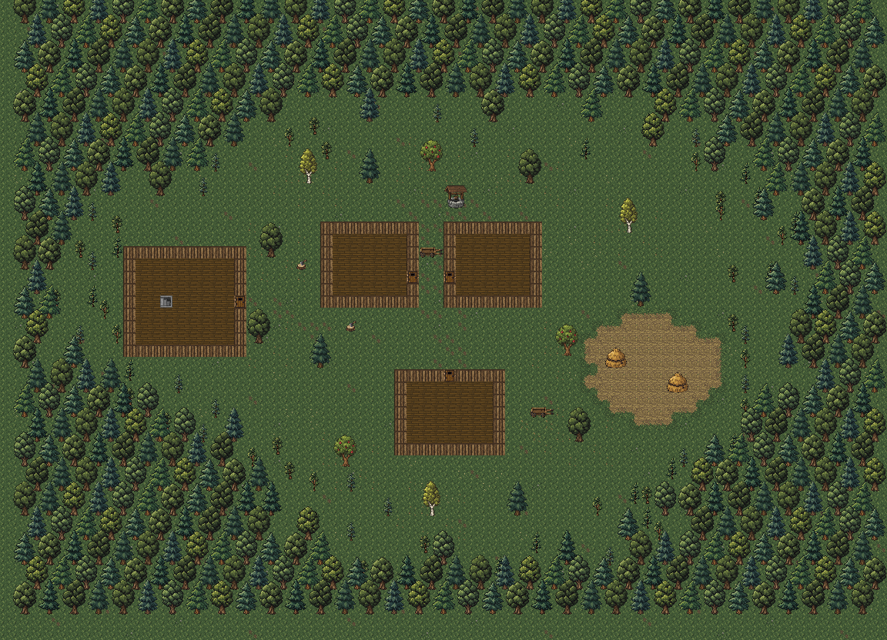
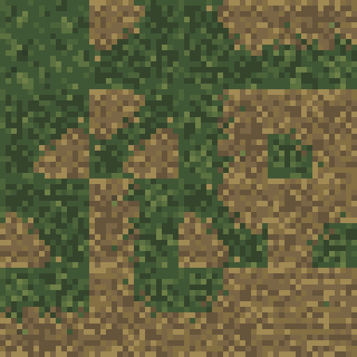

# Небольшое поле справа от домов

Дата: 2026-11-02.

По просьбе Автора справа от жилых домов добавлено небольшое поле с отдельной
текстурой вместо травы. Все стоги сена находятся только на нём. После
уточнения Автора прямоугольная форма заменена неровным округлым контуром
с переходами от луговой травы к стерне, небольшими выступами и впадинами.



Схема собрана из игровых ресурсов без запуска игры. Стены и двери показаны
плоскими тайлами, интерьеры условно пустые; освещение и туман войны
не моделируются. Это схема размещения, а не игровой скриншот.

## Ресурс

- [surface_field.png](../../core/src/main/assets/environment/surface_field.png) —
  полностью непрозрачный PNG 16×16 со скошенной стернёй, соломой и землёй.
- [tiles_surface.png](../../core/src/main/assets/environment/tiles_surface.png) —
  атлас расширен с 256×256 до 256×272; основной тайл поля остаётся в слоте 21,
  прямоугольник (80, 16)–(95, 31). Все 65 536 пикселей прежней версии сохранены.
- [surface_field_edge.png](../../core/src/main/assets/environment/surface_field_edge.png) —
  сторона: трава сверху, поле снизу.
- [surface_field_corner.png](../../core/src/main/assets/environment/surface_field_corner.png) —
  выпуклый угол: поле в нижней правой части.
- [surface_field_inset.png](../../core/src/main/assets/environment/surface_field_inset.png) —
  вогнутый угол: трава заходит в поле с верхнего левого угла.
- [surface_field_edges.png](../../core/src/main/assets/environment/surface_field_edges.png) —
  полоса 256×16 из 16 вариантов стыков, добавленная в новую строку атласа,
  слоты 256–271, прямоугольник (0, 256)–(255, 271).

Текстура создана встроенным `image_gen`; CLI не использовался.
Референс — существующий `surface_grass.png`. Исходный результат 1254×1254
уменьшен выборкой центров 16×16 целевых ячеек без интерполяции.
Цвета приведены к ближайшему цвету ограниченной палитры по расстоянию RGB:
`#514735 #66543b #7b6646 #847043 #a18a54 #405735 #4d633a`.
Стоги используют прежние рисунки; их текстуры не менялись.

Три исходных перехода 16×16 созданы отдельными вызовами встроенного
`image_gen` по существующим траве и полю. Каждый результат 1254×1254
уменьшен выборкой центров 16×16 целевых ячеек без интерполяции.
Палитра переходов объединяет пять коричневых оттенков поля с шестью зелёными
оттенками травы: `#35452c #405735 #4d633a #5c7140 #6e8047 #2d3d29`.
Остальные направления получены поворотами на 90°. Пограничные ряды пикселей
согласованы с исходными материалами и серединой стороны тайла, чтобы соседние
переходы стыковались. Два диагональных сочетания составлены из противоположных
выпуклых углов; текущая форма их не использует. Все новые тайлы непрозрачны.



## Размещение и свойства

Поле вместе с переходами занимает 96 клеток внутри рамки 12×10:
x = 47–58, y = 25–34 на карте 72×52, координаты от нуля.
`SurfaceFloorTiles.FIELD_SHAPE` задаёт форму сеткой 13×11 угловых отметок
относительно центра карты: левый верхний угол в (+11, −1).
Каждый символ `#` означает поле, `.` — луг. Четыре отметки клетки выбирают
стык: биты 1, 2, 4, 8 идут по часовой стрелке от северо-западного угла.
Пустая маска оставляет обычную мозаику луга, полная использует слот 21,
остальные выбирают слот `256 + mask`. Случайного выбора нет.
Трава и стерня перемежаются в кромке; выпуклые и вогнутые участки контура
используют свои переходы вместо прямых углов прямоугольника.
Типы клеток и их свойства не меняются: поле проходимо, пропускает обзор,
не добавляет взаимодействий, растений или собираемых предметов.

В `SurfaceLevel.decorateYards()` остаются ровно два стога:

| Стог | Основание | Верхний ряд |
| --- | --- | --- |
| Прежний восточный | (49–50, 29) | (49–50, 28) |
| Перенесённый из пространства между домами | (54–55, 31) | (54–55, 30) |

Оба рисунка целиком внутри поля. Других стогов в новом плане нет.
Соломенные маски вокруг прежних мест удалены; небольшая россыпь соломы
у южной телеги сохранена. Поле не пересекается с домами, деревьями
или лесными препятствиями. Стоги по-прежнему непроходимы и закрывают обзор.

Покрытие, новый контур и переходы действуют после загрузки уже существующей
поверхности; прямоугольное поле из предыдущей сборки получает новую форму.
Перенос стога применяется при первом создании карты; сохранённая карта
не перестраивается. Если поверхность уже посещена, для нового размещения
стогов нужно новое прохождение. Миграция не добавлялась.

## Проверка

Проверены статическая схема, 96 клеток покрытия с кромкой, размеры
и непрозрачность переходов, совпадение всех 16 тайлов с новой строкой атласа
и неизменность всех 65 536 пикселей прежней части набора.
Подтверждены два стога внутри поля и отсутствие пересечений области поля
с существующими препятствиями. Проверен diff.

`:core:compileJava` и `:android:assembleDebug` успешны. APK сразу установлен
обновлением на планшет по Wi-Fi ADB с явным serial
`adb-eb278ce2-Gf1NFr._adb-tls-connect._tcp` (`Success`).
Версия `4.0.2-INDEV` подтверждена. Подпись APK проверена;
шесть текстур в APK совпадают с исходниками по SHA-256.
Игра, автотесты и игровые сценарии не запускались.

## Промпты переходов

Для каждого из трёх вызовов использованы общая часть и свой вариант ниже.
`transparent_background: false`; референсы — `surface_grass.png` и
`surface_field.png`. Использован встроенный `image_gen`, CLI не использовался.

```text
Use case: style-transfer. Asset type: ONE opaque 16x16 terrain transition tile for Shattered Pixel Dungeon. Input 1 is the grass material reference; input 2 is the cut hay-field material reference. Match both materials' muted colors, flat top-down ground plane and chunky native pixel clusters. The grass should remain dark olive (#35452c #405735 #4d633a #5c7140 #6e8047 #2d3d29); the field should remain subdued brown ochre (#514735 #66543b #7b6646 #847043 #a18a54), never bright yellow. Draw an organically broken blending boundary, with 1-3 native pixel clumps of olive grass and fallen straw intermingling across a 4-pixel-wide transition band. No dark outline, no raised ridge, no cast shadow, no blur, no gradient, no perspective, no grid, no text, no objects or haystacks. ONE square tile filling the entire canvas edge to edge, 16x16 logical pixels enlarged uniformly as square blocks, NO extra margins. The material along each side must match the supplied references for seamless stitching.
```

### Сторона

```text
Composition: a horizontal terrain boundary roughly across native row 8. Upper half is grass reaching the entire top edge; lower half is field reaching the entire bottom edge. Both the left and right edges cross from grass to field exactly at their vertical midpoint. Make the transition irregular, gently staggered, with tufts and scattered stubble interlocking. Grass retreats gradually into harvested ground; no straight visible line.
```

### Выпуклый угол

```text
Composition: an OUTER ROUNDED CORNER of the field. The field occupies ONLY the lower-right quarter, curving from the RIGHT EDGE midpoint to the BOTTOM EDGE midpoint. The remaining upper/left three quarters are grass. The top and left edges are 100 percent grass. The bottom edge is grass in its left half and field in its right half; the right edge is grass in its upper half and field in its lower half. A broad organic rounded arc with grass tufts interlocking with straw, not a square 90-degree corner and not a diagonal straight stripe.
```

### Вогнутый угол

```text
Composition: an INNER ROUNDED CORNER, where grass makes a small concave bite into the field at the UPPER LEFT. Grass occupies ONLY the upper-left quarter; the other three quarters are cut field. The boundary curves from the TOP EDGE midpoint to the LEFT EDGE midpoint. The bottom and right edges are 100 percent field. The top edge is grass on its left half and field on its right half; the left edge is grass on its upper half and field on its lower half. Organic rounded arc with tiny grass tufts and straw interlocking, no square corner or hard diagonal.
```

## Промпт основного тайла

`transparent_background: false`; референс — `surface_grass.png`.

```text
Use case: style-transfer. Asset type: one opaque 16x16 ground-tile variant for a top-down pixel-art RPG. Input image 1 is the existing grass tile and the style reference. Transform this grass into a recently cut hay field: subdued earthy ochre and brown soil covered in short golden stubble and a few fallen straw stems, with slight uneven horizontal rows suggesting harvested ground. This is a flat walkable ground texture replacing grass beside the village, NOT tall crops. Keep the chunky low-resolution pixel-cluster style, subdued contrast and scale of Shattered Pixel Dungeon. Output ONE square seamless tile filling the canvas edge to edge, EXACTLY 16 columns by 16 rows of logical pixels, each logical pixel a large uniform solid-color square. Muted colors around #514735 #66543b #7b6646 #847043 #a18a54, a few olive remnants around #405735 #4d633a; make the field visibly warmer and drier than the reference grass without bright yellow. Soil/stubble continues through all four edges, no border, no grass frame. No object, no haystack, no fence, no growing plants, no path, no perspective, no cast shadow, no gradient, no antialiasing, no fine noise, no text, no watermark, no labels, no panels.
```
