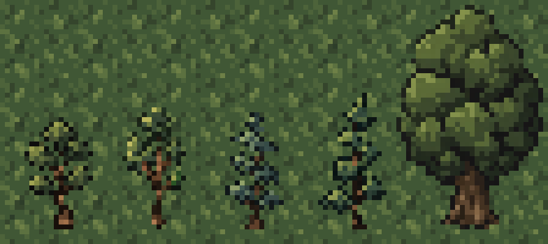
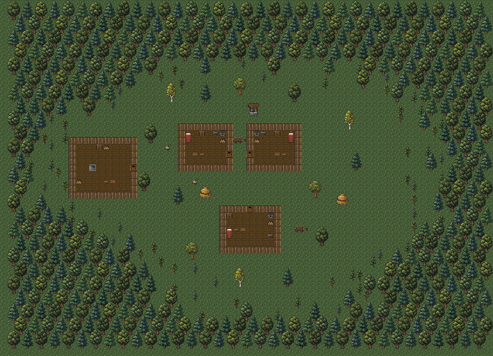

# Саженцы и постепенная лесная опушка

Дата: 2026-11-02.

По просьбе Автора добавлены два варианта саженцев дуба и два сосны.
Каждый получен отдельным вызовом встроенного `image_gen` с прозрачным фоном
по [листу прежних деревьев](surface-forest-trees.png). CLI не использовался.

Саженцы непроходимы, но прозрачны для обычного обзора. Ствол и листва
сохраняют обычную плотность цвета; просветы между ветвями и фон прозрачные.



## Ресурсы

Все четыре отдельных PNG имеют размер 16×32 пикселя. Рисунки заметно ниже
прежних взрослых деревьев 32×48, с тонкими стволами и редкими ветвями.

| Вариант | PNG | Рисунок внутри PNG | Колонка атласа |
| --- | --- | --- | --- |
| Молодой дуб | [oak_sapling.png](../../core/src/main/assets/environment/exterior/oak_sapling.png) | 14×23 | 32 |
| Второй молодой дуб | [oak_sapling_2.png](../../core/src/main/assets/environment/exterior/oak_sapling_2.png) | 13×26 | 33 |
| Молодая сосна | [pine_sapling.png](../../core/src/main/assets/environment/exterior/pine_sapling.png) | 12×25 | 34 |
| Вторая молодая сосна | [pine_sapling_2.png](../../core/src/main/assets/environment/exterior/pine_sapling_2.png) | 14×28 | 35 |

[surface_exterior.png](../../core/src/main/assets/environment/custom_tiles/surface_exterior.png)
расширен с 512×48 до 576×48. Все 24 576 пикселей прежней части сохранены
точно, включая прозрачность. Саженцы добавлены в строки 16–47,
с общей нижней линией прежнего атласа. Другие ресурсы не перерисованы.

Границы обрезки определены по альфа-каналу с порогом 128. Внутри них
выбраны ближайшие пиксели из центров целевых ячеек, без интерполяции
и перекраски. Выбранные цвета и альфа сохранены. Каждый рисунок
выровнен по центру PNG; нижняя линия находится в строке 30,
под ней один прозрачный ряд.

| PNG | Исходный размер | Обрезка: x, y, ширина, высота |
| --- | --- | --- |
| oak_sapling | 887×1774 | 170, 741, 550, 942 |
| oak_sapling_2 | 887×1774 | 148, 530, 568, 937 |
| pine_sapling | 887×1774 | 223, 499, 471, 1026 |
| pine_sapling_2 | 887×1774 | 185, 445, 509, 975 |

## Размещение и свойства



Это статическая композиция ресурсов без запуска игры. Она показывает
новое размещение леса и прежние дома и дворовые объекты. Стены и двери
показаны плоскими тайлами, трава — базовым тайлом; мебель амбара
показана частично. Освещение, туман войны и игровые сценарии не моделируются.

Опушка состоит из 64 саженцев (29 дубов и 35 сосен) и 36 отдельно стоящих
взрослых деревьев, чередующихся с травяными просветами. Дальше находятся
408 деревьев непрерывной замкнутой чащи. Лес начинается разреженными
неровными группами, куда можно подойти между деревьями, и уплотняется
к внешней части карты. Прежние 14 дворовых деревьев сохранены.
Карта остаётся 72×52, координаты домов, амбара, жителей и квестовых
объектов не менялись.

`SurfaceForest.PLAN` содержит фиксированную схему 35×25 участков:
точки оставляют траву; цифры 0–9 задают сплошную чащу с прежними десятью
взрослыми вариантами; A–J выбирают те же варианты отдельно стоящих деревьев;
a/b — два молодых дуба, c/d — две молодые сосны. Выбор и положение
заданы в схеме без `Random` или seed.

| Растительность | Непроходимая область | Обычный обзор |
| --- | --- | --- |
| Сплошная чаща | Весь участок 2×2, включая пространство между стволами | Перекрывает |
| Отдельное взрослое дерево на опушке | Основание 2×1 | Перекрывает |
| Саженец | Одна клетка у ствола | Пропускает |
| Трава между отдельными деревьями и под кронами | Проходима | Пропускает |

Ряды участков смещены по горизонтали на клетку. Четыре варианта саженцев
занимают разные углы участков, чтобы их стволы не выстраивались в ровные линии.
Внешняя чаща остаётся замкнутой; проходы в другие секции не добавлялись.

`SurfaceForest` сохраняет оба общих слоя: основания в `customTiles`,
кроны в `customWalls`. Размеры рисунков и непроходимая область
зависят от вида растительности. `SurfaceLevel.exteriorBlocksSight()`
использует `containsCell()` и `blocksSight()`, поэтому саженцы
пропускают обзор при создании, загрузке и обновлении клетки.
Массив растительности, прямоугольник и слой сохраняются через `Bundle`.

Осмотр саженца показывает целый рисунок и русское/английское название
и описание. Рубка, сбор ресурсов и рост деревьев не добавлялись.
Новый план появляется при первом создании поверхности; уже посещённая
поверхность не перестраивается, для неё нужно новое прохождение.

## Проверка

`:core:compileJava` и `:android:assembleDebug` успешны.
APK сразу установлен обновлением на планшет по Wi-Fi ADB
с явным serial `adb-eb278ce2-Gf1NFr._adb-tls-connect._tcp`
(`Success`). Подтверждены пакет
`com.shatteredpixel.shatteredpixeldungeon.indev` и версия `4.0.2-INDEV`.
Подпись APK проверена.

Проверены статическая схема, размеры и прозрачность PNG, совпадение новых
рисунков со слотами и сохранность всех пикселей прежней части атласа.
Ключи описаний совпадают в русской и английской локализациях.
Четыре новых PNG, атлас и обе локализации в APK совпадают с исходниками
по SHA-256. Проверен diff. Игра, автотесты и игровые сценарии не запускались.

## Промпты

Каждый вызов использовал общий префикс, затем строку `Subject:`
и текст своего варианта. Референс — `surface-forest-trees.png`;
`transparent_background: true`.

```text
Use case: stylized-concept.
Asset type: ONE small sapling sprite for the same pixel-art RPG as the reference.
Input image 1 is a STYLE AND SPECIES REFERENCE sheet: pines in the top row, oaks in the bottom row, enlarged game sprites on grass. Keep their chunky native low-resolution pixel clusters, upper-left lighting, near-black shadows, subdued green/brown palette and slightly elevated frontal orthographic view. Draw ONLY the requested young tree, no reference grass or other trees.
Final native canvas 16x32 pixels. The sapling must look YOUNG and airy, slender brown trunk clearly visible with a few separated branches and foliage clumps, with actual transparent gaps between them. It is about half the height of the adult 32x48 tree. Solid opaque bark and foliage pixels; the surroundings and gaps are genuinely transparent, NOT a ghostly semitransparent tree. Logical native pixel grid enlarged as square pixel blocks with nearest-neighbour, no antialiasing, gradients or fine texture. Center horizontally, bottom baseline at native row30, about one pixel side padding. Full sapling visible.
Avoid text, labels, borders, grids, scenery, ground, grass tufts, rocks, pots, external shadows, glow and any additional objects.
```

### oak_sapling

```text
ONE young OAK sapling, native silhouette 14x23 pixels, small rounded irregular crown of muted olive-green leaf clumps, thin slightly bending brown trunk with a small fork, four airy leaf clusters and visible gaps. Match the oak row's palette, lighter highlights kept subdued.
```

### oak_sapling_2

```text
ONE young OAK sapling, native silhouette 13x26 pixels, slightly taller slender stem, asymmetrical little oak crown with a stronger left branch and three to five leaf clusters, subtly cooler muted forest-green leaves than variant one. Visible brown fork and transparent gaps among the branches.
```

### pine_sapling

```text
ONE young PINE sapling, native silhouette 12x25 pixels, slender upright brown stem and three small widely spaced triangular tiers of muted blue-green needles. Delicate uneven branch tips and transparent gaps between tiers. Clearly a young pine, not a miniaturized dense adult tree.
```

### pine_sapling_2

```text
ONE young PINE sapling, native silhouette 14x28 pixels, slightly leaning tip and four sparse staggered branch tiers, one lower branch longer, muted moss-green needle highlights over deep green shadows. Thin visible brown stem with transparent gaps separating branch tiers.
```
