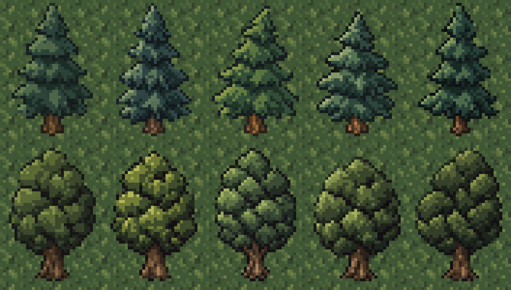
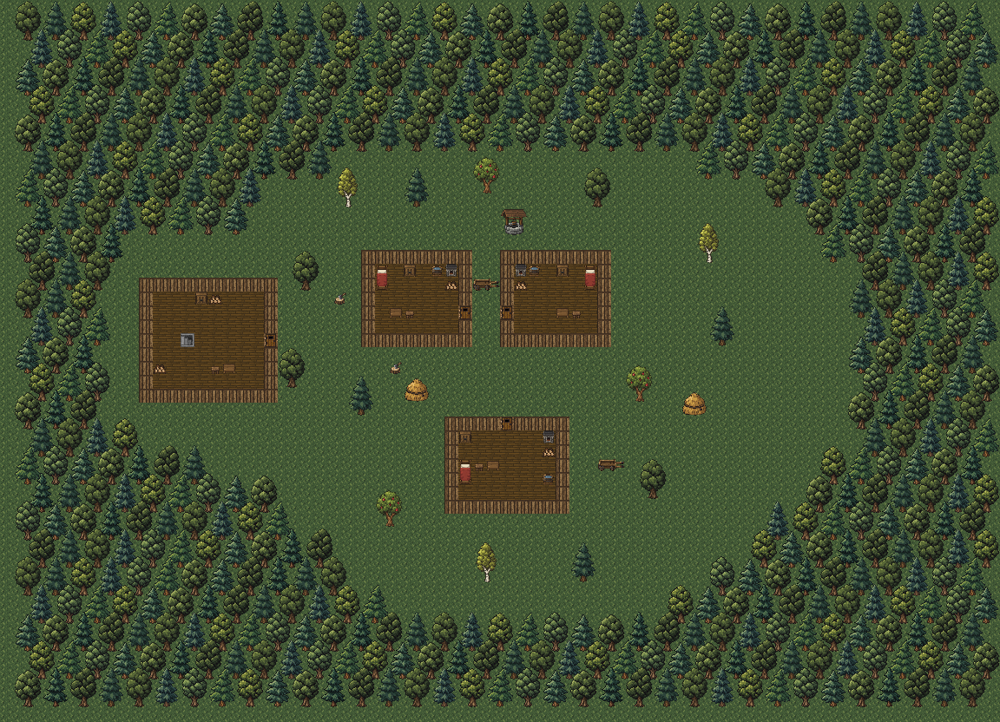

# Лес вокруг стартовой деревни

Дата: 2026-11-02.

Этот документ описывает первый этап плотной лесной границы. В последующем
уточнении того же дня добавлены саженцы и постепенная смешанная опушка;
актуальные ресурсы, схема и поведение — в [оформлении опушки](surface-forest-edge.md).

По просьбе Автора сохранены исходные одобренные сосна и дуб и созданы
по четыре дополнительных варианта каждого вида. Все восемь новых рисунков
получены отдельными вызовами встроенного `image_gen` с прозрачным фоном.
Референс каждого вызова — исходное дерево своего вида, увеличенное в 16 раз
без сглаживания. CLI и внешние API не использовались.



## Ресурсы

Все отдельные PNG имеют прозрачный фон и размер 32×48 пикселей.
Они находятся в [environment/exterior](../../core/src/main/assets/environment/exterior/).
Различаются оттенки зелени, ширина, высота и асимметрия ветвей или кроны.

| Вариант | PNG | Колонки атласа | Размер рисунка |
| --- | --- | --- | --- |
| Дуб, исходный | [oak.png](../../core/src/main/assets/environment/exterior/oak.png) | 0–1 | 30×46 |
| Дуб 2, тёплый оливковый | [oak_2.png](../../core/src/main/assets/environment/exterior/oak_2.png) | 16–17 | 30×45 |
| Дуб 3, вытянутая крона | [oak_3.png](../../core/src/main/assets/environment/exterior/oak_3.png) | 18–19 | 28×46 |
| Дуб 4, широкая низкая крона | [oak_4.png](../../core/src/main/assets/environment/exterior/oak_4.png) | 20–21 | 30×43 |
| Дуб 5, тёмный асимметричный | [oak_5.png](../../core/src/main/assets/environment/exterior/oak_5.png) | 22–23 | 30×46 |
| Сосна, исходная | [pine.png](../../core/src/main/assets/environment/exterior/pine.png) | 4–5 | 28×46 |
| Сосна 2, узкая сизая | [pine_2.png](../../core/src/main/assets/environment/exterior/pine_2.png) | 24–25 | 26×46 |
| Сосна 3, широкие нижние ветви | [pine_3.png](../../core/src/main/assets/environment/exterior/pine_3.png) | 26–27 | 30×45 |
| Сосна 4, светлая компактная | [pine_4.png](../../core/src/main/assets/environment/exterior/pine_4.png) | 28–29 | 28×43 |
| Сосна 5, тёмная несимметричная | [pine_5.png](../../core/src/main/assets/environment/exterior/pine_5.png) | 30–31 | 28×46 |

[surface_exterior.png](../../core/src/main/assets/environment/custom_tiles/surface_exterior.png)
расширен с 256×48 до 512×48. Все 12 288 пикселей старой половины сохранены
точно, включая альфа-канал. Берёза, яблоня и дворовые объекты остались
в прежних колонках; `SurfaceExterior` использует новую ширину строки.

## Подготовка

Границы рисунка определены по альфа-каналу с порогом 128. Внутри обрезки
выбраны ближайшие пиксели из центров целевых ячеек без интерполяции,
перекраски или ручного изменения формы. Выбранные RGB и альфа сохранены.
Рисунок выровнен по центру PNG с одним прозрачным рядом снизу,
основание — в строке 46 (нумерация от нуля).

| PNG | Исходный размер | Обрезка: x, y, ширина, высота |
| --- | --- | --- |
| pine_2 | 1023×1537 | 134, 71, 756, 1397 |
| pine_3 | 1024×1536 | 32, 32, 959, 1471 |
| pine_4 | 1024×1536 | 120, 168, 806, 1324 |
| pine_5 | 1024×1536 | 65, 51, 878, 1441 |
| oak_2 | 1023×1537 | 20, 47, 988, 1465 |
| oak_3 | 1024×1536 | 64, 42, 896, 1483 |
| oak_4 | 1023×1537 | 27, 131, 972, 1343 |
| oak_5 | 1024×1536 | 32, 33, 972, 1473 |

## Размещение



Это статическая композиция ресурсов, а не снимок запущенной игры.
Она показывает координаты деревьев, лесные слои, дома и дворовые объекты.
Стены и двери показаны плоскими тайлами, трава — базовым тайлом;
мебель амбара показана частично. Освещение и туман войны не моделируются.

Карта уменьшена со 100×100 до 72×52 клетки. Центр плана — (36, 26).
Взаимное расположение домов, амбара, отдельных дворовых деревьев, мебели,
NPC и квестовых предметов сохранено. Все их координаты из предыдущего
плана сместились на −14 по x и −24 по y.

| Объект | Актуальное положение |
| --- | --- |
| Амбар | (10, 20), 10×9; дверь (19, 24), лестница (13, 24) |
| Северо-западный дом | (26, 18), 8×7; дверь (33, 22) |
| Северо-восточный дом | (36, 18), 8×7; дверь (36, 22) |
| Южный дом | (32, 30), 9×7; дверь (36, 30) |
| Дровосек | (30, 21) |
| Бабушка | (38, 31) |
| Колодец | Основание (36–37, 16) |
| Квестовая телега | (34–35, 20); площадка после перемещения (32–33, 16) |
| Сундук с доской | (42, 21) |

`SurfaceForest.PLAN` — фиксированная схема 35×25 символов:
точка оставляет лужайку, цифры 0–4 выбирают пять дубов, 5–9 — пять сосен.
В кольце 515 деревьев: 256 дубов и 259 сосен. Прежние 14 дворовых деревьев
сохранены отдельно. Каждый символ леса заполняет 2×2 клетки непроходимым
`Terrain.SURFACE_DECO`; соседние ряды смещены на одну клетку по горизонтали.
Замкнутая граница перекрывает и ходьбу, и обычный обзор, включая промежутки
между стволами. Под нависающим за заросль северным краем кроны клетка
сохраняет свой прежний тип.

Основания всего леса рисует один `CustomTilemap` в `customTiles`,
кроны — второй в `customWalls`. Отдельные сотни объектов отрисовки
не создаются. Варианты деревьев, прямоугольник и слой сохраняются через
`Bundle`. При осмотре доступны целый рисунок, прежнее название породы
и новое русское/английское описание густой заросли.

Лес и новый размер применяются при первом создании поверхности.
Уже посещённая карта загружается без перестройки; для неё нужно новое
прохождение. Рубка и новые переходы между секциями не добавлялись.

## Проверка

`:core:compileJava` и `:android:assembleDebug` прошли успешно.
APK сразу установлен обновлением на планшет по Wi-Fi ADB
(`adb-eb278ce2-Gf1NFr._adb-tls-connect._tcp`, `Success`).
Подтверждены пакет `com.shatteredpixel.shatteredpixeldungeon.indev`
и версия `4.0.2-INDEV`. Подпись APK проверена.

Проверены размеры и прозрачность PNG, совпадение новых рисунков со слотами,
сохранность всех пикселей старой половины атласа, статическая композиция,
локализации и diff. Восемь новых PNG, игровой атлас и обе локализации
в APK совпадают с исходниками по SHA-256. Игра, автотесты и игровые
сценарии не запускались.

## Промпты

Каждый вызов использовал общий префикс ниже, строку `Subject variant:`
и свой текст варианта. В `referenced_image_paths` передавался увеличенный
исходный `pine.png` или `oak.png`, `transparent_background: true`.

Общий префикс:

```text
Use case: stylized-concept.
Asset type: a single pixel-art tree sprite for the current Shattered Pixel Dungeon based RPG, intended final size 32x48 native pixels.
Input image 1: style and species reference, an approved existing sprite enlarged with nearest neighbour, DO NOT replace this original. Generate ONE additional matching tree.
Style: exactly match the reference's chunky low-resolution pixel clusters, subdued forest palette, near-black outline/shadows, upper-left highlights and simple short brown trunk. Slightly elevated orthographic frontal view, no isometric diagonal. Draw on a logical 32x48 grid, enlarged with aligned solid square pixels, no smooth detail or antialiasing. Similar silhouette scale and density to the reference. All foliage opaque inside tree; only background truly transparent. Full tree centered, baseline at logical row 46, about 1 pixel clear padding, no cropping.
Constraints: ONE tree only, no text, grid, alternate views, ground, grass, rocks, sky, scenery, external cast shadows, snow or props. Subtle natural difference in shape AND hue; same summer forest, no drastic seasonal change.
```

### pine_2

```text
ONE PINE TREE: slightly narrower and more upright than the reference, four distinct staggered bough tiers, slightly cooler desaturated blue-green needles, compact crown with uneven left/right branch tips. Native silhouette 26x46px.
```

### pine_3

```text
ONE PINE TREE: slightly broader lower boughs and a subtly leaning tip, three broad stepped tiers with a small upper tuft, slightly warmer deep moss-green needles than reference. Native silhouette 30x45px.
```

### pine_4

```text
ONE PINE TREE: compact slightly shorter irregular triangular crown, layered branches with a wider middle tier and shorter upper tier, subtly lighter grey sage-green needle highlights over deep green shadows. Native silhouette 28x43px.
```

### pine_5

```text
ONE PINE TREE: tall asymmetrical conical crown, four angular stepped branch tiers, left lower branch slightly longer and right middle tier raised, subtly deeper dark spruce-green hue than reference. Native silhouette 28x46px.
```

### oak_2

```text
ONE OAK TREE: rounded dense canopy with slightly wider lower lobes and a small uneven top, subtly warmer muted olive-green foliage than reference; short thick rooted brown trunk. Native silhouette 30x45px.
```

### oak_3

```text
ONE OAK TREE: more upright oval canopy, irregular broad leaf lobes with a slight notch in the upper right, subtly cooler muted forest-green foliage than reference; short thick brown trunk with modest fork just below canopy. Native silhouette 28x46px.
```

### oak_4

```text
ONE OAK TREE: slightly squat broad rounded canopy, a more pronounced bulge on left and small scalloped right edge, subtly lighter subdued moss-green highlights than reference, short sturdy brown trunk. Native silhouette 30x43px.
```

### oak_5

```text
ONE OAK TREE: slightly asymmetrical round crown with top leaning right and a lower foliage lobe left, subtly deeper dark olive-green foliage than reference; short brown trunk with tiny visible roots. Native silhouette 30x46px.
```
