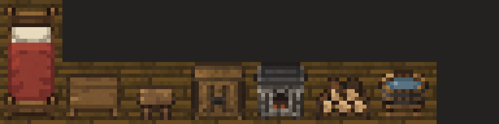
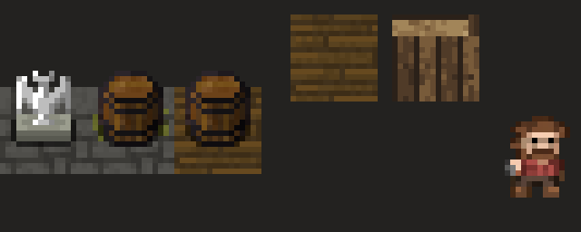
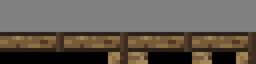

# Интерьер домов поверхности

Дата: 2026-11-01.

По просьбе Автора встроенным `image_gen` сгенерированы семь отдельных
элементов интерьера в пиксельной стилистике игры. Каждый предмет создавался
отдельным вызовом с прозрачным фоном. CLI и внешние API не использовались.



## Файлы и масштаб

Прозрачные изображения находятся в
[environment/furniture](../../core/src/main/assets/environment/furniture/).
Игра использует собранный атлас
[surface_furniture.png](../../core/src/main/assets/environment/custom_tiles/surface_furniture.png)
размером 128×32 пикселя.

| Колонка атласа | Предмет | Прозрачный PNG | Занимаемые клетки |
| --- | --- | --- | --- |
| 0 | Кровать | [bed.png](../../core/src/main/assets/environment/furniture/bed.png), 16×32 | 1×2 |
| 1 | Стол | [table.png](../../core/src/main/assets/environment/furniture/table.png), 16×16 | 1×1 |
| 2 | Табурет | [stool.png](../../core/src/main/assets/environment/furniture/stool.png), 16×16 | 1×1 |
| 3 | Шкаф | [cupboard.png](../../core/src/main/assets/environment/furniture/cupboard.png), 16×16 | 1×1 |
| 4 | Печь | [stove.png](../../core/src/main/assets/environment/furniture/stove.png), 16×16 | 1×1 |
| 5 | Поленница | [firewood.png](../../core/src/main/assets/environment/furniture/firewood.png), 16×16 | 1×1 |
| 6 | Умывальник | [washbasin.png](../../core/src/main/assets/environment/furniture/washbasin.png), 16×16 | 1×1 |

Каждая колонка атласа имеет размер 16×32. Кровать использует оба тайла
колонки 0 (индексы 0 и 8); остальные предметы — только нижний тайл
с индексом `8 + type.ordinal()`. Колонка 7 и верхние тайлы колонок 1–6
пустые. Под используемыми тайлами лежит существующий деревянный пол
`FLOOR_SP` (слот 4) из `tiles_surface.png`: под `CUSTOM_DECO` движок
иначе нарисовал бы обычный травяной пол поверхности.

## Референс и подготовка

Референсом служила увеличенная в шесть раз подборка действительных ресурсов:
статуя и обе бочки из `tiles_sewers.png`, деревянные пол и стена из
`tiles_surface.png`, основной кадр `sprites/lumberjack.png`.
Статуя и бочки собраны из нижних тайлов 128, 130, 131 и верхних 240, 242, 243.
Референс задавал масштаб, ракурс, палитру и характер крупных пикселей.



При подготовке каждого PNG найдены границы рисунка по альфа-каналу
(порог 128). Рисунок уменьшен выборкой ближайшего пикселя из центра каждой
целевой ячейки, без интерполяции и изменения выбранных цветов и прозрачности.
Он выровнен по нижней границе с одним прозрачным пикселем снизу и
горизонтально по центру.

| Предмет | Исходный размер | Обрезка (x, y, ширина, высота) | Размер рисунка внутри PNG |
| --- | --- | --- | --- |
| Кровать | 887×1774 | (113, 139, 661, 1494) | 14×30 |
| Стол | 1254×1254 | (177, 274, 901, 787) | 14×12 |
| Табурет | 1254×1254 | (327, 470, 601, 575) | 10×9 |
| Шкаф | 1254×1254 | (195, 192, 864, 887) | 14×15 |
| Печь | 1254×1254 | (177, 234, 901, 902) | 14×15 |
| Поленница | 1254×1254 | (155, 313, 946, 749) | 14×11 |
| Умывальник | 1254×1254 | (196, 155, 862, 961) | 13×13 |

## Размещение и поведение

`SurfaceLevel.build()` обставляет три дома по фиксированным планам:
`furnishLumberjackHouse()`, `furnishNorthEastHouse()`, `furnishSouthHouse()`.
В каждом доме семь предметов, всего 21 предмет на 24 клетках.
Координаты ниже считаются от нуля; для кровати указана верхняя клетка.

| Предмет | Северо-западный дом | Северо-восточный дом | Южный дом |
| --- | --- | --- | --- |
| Кровать | (41, 43) | (60, 43) | (47, 57) |
| Стол | (42, 46) | (58, 46) | (49, 57) |
| Табурет | (43, 46) | (59, 46) | (48, 57) |
| Шкаф | (43, 43) | (58, 43) | (47, 55) |
| Печь | (46, 43) | (55, 43) | (53, 55) |
| Поленница | (46, 44) | (55, 44) | (53, 56) |
| Умывальник | (45, 43) | (56, 43) | (53, 58) |

Предметы находятся только внутри домов, в стороне от дверей и Дровосека
(44, 45). Нижний ряд пола оставлен без мебели, чтобы её не перекрывали
нависающие южные стены.



`SurfaceFurniture extends CustomTilemap` рисует мебель через
`Level.customTiles`. Под мебелью — `Terrain.CUSTOM_DECO` с флагом
`SOLID`, без `PASSABLE` и `LOS_BLOCKING`, как у статуй. Все семь видов мебели
пропускают обзор, оставаясь непроходимыми; у кровати это правило действует
для обеих клеток. Тип предмета и его прямоугольник
сохраняются стандартным механизмом `Bundle`. При осмотре отображаются
название, описание и изображение всего предмета, включая целую кровать
при выборе любой из двух её клеток. Русские и английские строки:
`tiles.surfacefurniture.*` в `messages/levels/levels*.properties`.

Предметы — неподвижное оформление и препятствия; действия сна, хранения,
приготовления пищи и добычи ресурсов не добавлялись. Уже сохранённая
поверхность не перестраивается: новый интерьер появляется при создании
новой карты поверхности; для ранее посещённой поверхности нужно новое
прохождение.

## Промпты

Ниже приведены точные общий префикс и семь отдельных дополнений.
Каждый вызов использовал их конкатенацию, один и тот же референс и
`transparent_background: true`.

Общий префикс:

```text
Use case: stylized-concept. Asset type: production pixel-art furniture sprite for the existing Shattered Pixel Dungeon game, NOT concept art. The supplied image is STYLE REFERENCE ONLY: actual game statue, barrels, wood floor, timber wall, and 16-pixel-tall lumberjack enlarged 6x. Create ONE NEW interior object. Match their VERY low native resolution, simple chunky square pixels, modest muted palette, soft dark brown outlines, and slightly top-down frontal orthographic view. Visible top and front, left/right symmetric perspective, no diagonal isometric sides. Upper-left light, 3-4 flat shades per material, no smooth gradients, no antialiasing, no high-resolution details. Draw the sprite centered, occupying most of its native grid with 1-pixel transparent padding. Actual transparent background, no ground/floor/wall tile, no external cast shadow, no grid, no text, no watermark, no multiple objects or alternate views. Render the logical native pixel grid enlarged by an integer factor to a large canvas; every logical pixel must be a solid uniform square.
```

### bed

```text
ONE simple medieval single bed pointing north/south, headboard at TOP and footboard at BOTTOM, cream pillow and muted rust-red wool blanket, dark oak frame. Native grid exactly 16 columns by 32 rows; canvas 1:2 aspect ratio; bed about 13x29 logical pixels. Readable blocky bedding and two wooden bedposts, no ornate decoration.
```

### table

```text
ONE small square oak dining table, simple thick wooden top with three broad horizontal planks, short visible front legs; no objects on top. Native grid exactly 16x16, square canvas; table about 14x12 logical pixels. Similar apparent width to the reference barrel, slightly wider.
```

### stool

```text
ONE small squat four-legged wooden stool with a square oak seat, viewed from the same direction as the reference barrel. Native grid exactly 16x16, square canvas; stool about 10x9 logical pixels, centered toward lower half with baseline row14. Large simple seat and short legs; no chair back.
```

### cupboard

```text
ONE squat rustic wooden cupboard with two closed paneled doors and two tiny iron handles, a narrow visible top surface and short feet. Native grid exactly 16x16, square canvas; cupboard about 14x15 logical pixels. Dark muted oak, 3-4 wood shades matching reference wall/barrel. No books, no extra furniture, no tall real-life proportions.
```

### stove

```text
ONE compact medieval grey stone cooking stove with a dark arched opening and just two or three dull ember-orange pixels inside, a flat dark iron top. Native grid exactly 16x16, square canvas; stove about 14x15 logical pixels. Chunky grey stones in 3-4 grey-brown shades, modest light, no chimney, no fire/smoke particles, no pot.
```

### firewood

```text
ONE short tidy stack of cut firewood resting on two dark wooden supports, 5 or 6 chunky logs with light tan cut ends facing viewer and dark bark visible on top. Native grid exactly 16x16, square canvas; stack about 14x11 logical pixels. Large simple shapes, log rings hinted by single dark pixels, muted wood tones matching reference barrels, no axe or tools.
```

### washbasin

```text
ONE round low wooden washbasin standing on a squat simple wooden stand, with a few muted blue-grey water pixels inside and two dark iron bands around the tub. Native grid exactly 16x16, square canvas; basin and stand about 13x13 logical pixels. Clearly a shallow oval open bowl, not a closed barrel; no modern plumbing, no taps, no extra bucket.
```
