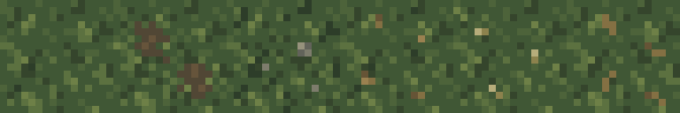
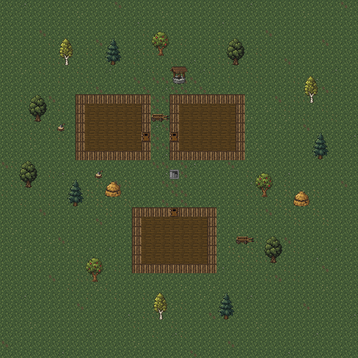

# Декоративные варианты травы поверхности

Дата: 2026-11-01.

По просьбе Автора встроенным `image_gen` созданы пять отдельных вариантов
обычного наружного пола. CLI и внешние API не использовались. Референс —
существующий [тайл травы](../../core/src/main/assets/environment/surface_grass.png),
увеличенный до 512×512 ближайшим соседом.



## Ресурсы

Все тайлы — полностью непрозрачные PNG 16×16. Они упакованы в существующий
[набор поверхности](../../core/src/main/assets/environment/tiles_surface.png)
256×256; основной тайл травы в слоте 0 сохранён.

| Вариант | Файл | Слот |
| --- | --- | --- |
| Небольшая грязь среди травы | [surface_grass_dirt.png](../../core/src/main/assets/environment/surface_grass_dirt.png) | 6 (`FLOOR_ALT_1`) |
| Мелкие камешки | [surface_grass_pebbles.png](../../core/src/main/assets/environment/surface_grass_pebbles.png) | 12 (`FLOOR_ALT_2`) |
| Редкие опавшие листья | [surface_grass_leaves.png](../../core/src/main/assets/environment/surface_grass_leaves.png) | 13 |
| Мелкие луговые цветы | [surface_grass_flowers.png](../../core/src/main/assets/environment/surface_grass_flowers.png) | 14 |
| Рассыпанные соломинки | [surface_grass_straw.png](../../core/src/main/assets/environment/surface_grass_straw.png) | 15 |

Слоты 13–15 не используются исходным `DungeonTileSheet`; новые номера
определены только в `SurfaceFloorTiles`. Остальные пиксели набора сохранены.

## Подготовка

Каждый исходный результат имеет размер 1254×1254. Для упаковки в сетку игры
взята выборка из центров 16×16 целевых ячеек без интерполяции.
У листьев, цветов и соломы тонкие детали местами меньше целевой ячейки:
для них дополнительно проверены позиции 1/4, 1/2 и 3/4 внутри ячейки;
при наличии тёплого неграссового цвета выбран самый светлый такой образец.
Это сохраняет мелкие сгенерированные детали при уменьшении.

Цвета приведены к ближайшему цвету ограниченной палитры по расстоянию RGB.
Общая зелёная палитра совпадает с исходной травой:
`#35452c #405735 #4d633a #5c7140 #6e8047 #2d3d29`.
Дополнительные цвета:

| Вариант | Палитра деталей |
| --- | --- |
| Грязь | `#514735 #66543b #7b6646` |
| Камешки | `#45483d #62635a #7d7c6c #96927c` |
| Листья | `#665436 #847043 #9a8150` |
| Цветы | `#b7ad7b #8c824d` |
| Солома | `#665436 #847043 #a18a54` |

Сглаживание, полупрозрачность и дополнительные спрайты предметов не добавлялись.

## Раскладка и свойства клеток

В оригинале `DungeonTileSheet.getVisualWithAlts()` подмешивает два варианта
обычного пола по `tileVariance`: основной — 47%, первый вариант — 48%,
второй — 5% при равномерном целочисленном значении 0–99.

Поверхность использует собственный `tiles/SurfaceFloorTiles.java`:
небольшая заранее составленная мозаика 24×19 повторяется по лугу,
а фиксированные маски относительно центра карты оформляют поселение.
В мозаике преобладает обычная трава, изредка встречаются грязь, камешки
и цветы. Возле колодца, в проходе между северными домами и к южной двери
расположена потёртая трава; возле десяти лиственных деревьев — листья;
возле двух стогов и южной телеги — соломинки. На тихих окраинах —
небольшие группы цветов. Случайные числа и seed для этой раскладки
не используются.

`DungeonTerrainTilemap.getTileVisual()` выбирает эти изображения только
для `SurfaceLevel` и клеток `Terrain.EMPTY` / `Terrain.SURFACE_DECO`.
Под основаниями наружных объектов сохраняется то же покрытие.
Деревянный пол домов (`EMPTY_SP`), мебель (`CUSTOM_DECO`), двери,
лестница и подземелья используют прежнюю отрисовку.
Декоративная трава не является `Terrain.GRASS`: проходимость, обзор,
горение, поиск, траты ходов и взаимодействия не меняются.
Камешки, листья, цветы и солома не являются собираемыми предметами.

Раскладка вычисляется при отрисовке, без записи в карту или сохранения.
Поэтому она действует и на уже созданной поверхности после загрузки.
Клетки, освободившиеся после перемещения квестовой телеги, получают
предусмотренное для этих координат покрытие как обычный наружный пол.



Схема собрана из ресурсов без запуска игры. Стены показаны плоскими,
интерьеры условно пустые; это иллюстрация распределения наружного пола,
а не игровой скриншот.

## Промпты

Общая часть каждого из пяти промптов:

```text
Use case: stylized-concept. Asset type: one opaque grass ground tile variant for a top-down medieval RPG. Reference image is the current game's grass tile enlarged with nearest neighbor. Create a NEW variant matching its muted olive palette, quiet low-contrast pixel terrain style of Shattered Pixel Dungeon, and scale. Output a SINGLE square tile filling the canvas edge to edge, as EXACTLY 16 columns by 16 rows of logical pixels, each logical pixel a large uniform solid-color square. Flat top-down ground, no raised object, no perspective, no cast shadow. Preserve approximately 80 percent grassy background, same restrained olive base around #35452c #405735 #4d633a #5c7140 #6e8047 #2d3d29. Details should be sparse 1-3 logical pixel clusters on grass, irregularly placed away from edges. Grass must continue through all four edges, with NO border and NO grid. Avoid high contrast, fine texture, realistic shading, antialiasing, gradients, text, letters, watermark, separate panels or a sprite sheet.
```

### Трава с грязью

```text
Primary request: short grass with two small irregular worn patches of dull earthy brown soil showing between the grass blades. Rough broken grassy edges; soil covers only about one fifth of the tile. Soil tones #514735 #66543b #7b6646. No footprints, path, rocks, leaves or flowers.
```

### Трава с камешками

```text
Primary request: short grass with three tiny scattered flat grey-brown pebbles, one 2-by-2 logical pixels and two smaller, spaced asymmetrically. Subdued stone tones #62635a #7d7c6c #96927c; tiny dark bottom edge. Keep them embedded and flat, not loot, not large boulders. No dirt patch, flowers or leaves.
```

### Опавшие листья

```text
Primary request: short grass with four small scattered dry oak leaves, dull ochre and muted brown, each at most 2 or 3 logical pixels, asymmetric natural scatter with a lot of grass visible. Leaf tones #665436 #847043 #9a8150. No branch, tree, dirt patch, pebbles, flowers or pile of leaves.
```

### Мелкие луговые цветы

```text
Primary request: short grass with three tiny clover-like meadow blossoms, each a single warm ivory pixel and one subdued ochre center nearby, surrounded by a couple small darker leaves. Sparse humble medieval village meadow, understated and easy to walk over. Flower tones #b7ad7b #8c824d. No large flower heads, no pink, no purple, no items or rocks.
```

### Соломинки

```text
Primary request: short grass with a few short fallen straw stems scattered flat, four thin broken angular strokes 1-by-2 or 1-by-3 logical pixels, dull golden ochre #847043 #a18a54 and darker #665436. Most of the image stays green. Loose straw near a medieval haystack, no hay pile, no item, no dirt patch, no rocks or flowers.
```
