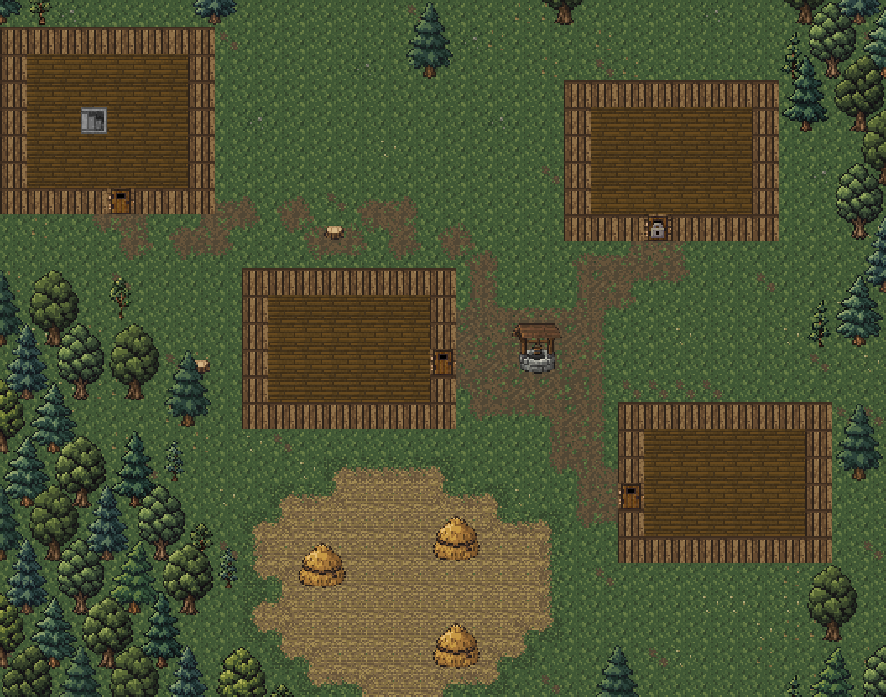
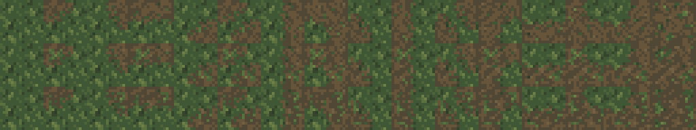
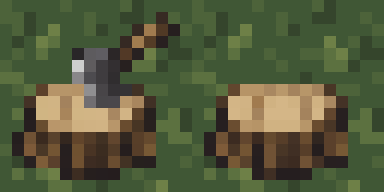

# Пни и вытоптанные дорожки Залесья

Дата: 2026-11-04. Изменения выполнены по указанию Автора.

Обе колоды с топором заменены пнями. Между дверями трёх жилых домов,
амбаром и площадью у колодца проложены декоративные грязевые дорожки:
примятая трава, участки уплотнённой земли и неровная кромка.

Это схема, собранная из игровых ресурсов без запуска игры. Стены и двери
показаны плоскими тайлами; мебель, NPC, освещение и туман войны опущены.
[Полная схема](surface-paths-layout.png).

## Генерация и ресурсы

Использован встроенный `image_gen`, без CLI/API-скриптов генерации.
Семь отдельных вызовов: правка исходной колоды, три материала дорожки,
прямой край, выпуклый и вогнутый углы. Полный текст каждого промпта,
параметры и пути исходных результатов — в
[наборе промптов](surface-paths-prompts.json). Исходные результаты сохранены
в [generated/stump-paths/](generated/stump-paths/).

Референсы: `environment/exterior/chopping_block.png`, `surface_grass.png`
и `surface_grass_dirt.png`; для переходов — также первый материал дорожки.
Референсы увеличивались без сглаживания. Результаты уменьшены до 16×16
выборкой центров логических пикселей; палитра приведена к цветам исходной
травы и сдержанным земляным оттенкам `#514735 #66543b #716044 #7b694b`.
У пня сохранена прозрачность, древесные оттенки взяты из исходной колоды.

| Ресурс относительно `core/src/main/assets/environment/` | Назначение |
| --- | --- |
| `exterior/stump.png` | Прозрачный пень 16×16 без топора. |
| `surface_path_a.png`, `surface_path_b.png`, `surface_path_c.png` | Три рисунка вытоптанной земли 16×16. |
| `surface_path_edge.png`, `surface_path_corner.png`, `surface_path_inset.png` | Сгенерированные исходные переходы 16×16. |
| `surface_path_tiles.png` | Готовые 48 тайлов 16×16: 16 угловых масок в трёх вариантах, включая пустую травяную маску. |
| `tiles_surface.png` | Расширен с 256×272 до 256×320; дорожки занимают слоты 272–319. |
| `custom_tiles/surface_exterior.png` | В существующем слоте колоды размещён пень; остальные пиксели сохранены. |

Четыре бита маски соответствуют северо-западному, северо-восточному,
юго-восточному и юго-западному углам. Повороты трёх исходных переходов
покрывают стороны и углы; две диагональные маски составлены из выпуклых
углов. Кромки вариантов согласованы с одной травой и одним образцом земли.
Внутри дорожки используются три сгенерированных рисунка. Код выбирает
варианты по постоянной мозаике, без случайных чисел.

## Пни

В `SurfaceExterior` сохранены внутренний тип `CHOPPING_BLOCK` и его слот
атласа: столбец 14, строка 2, прямоугольник (224, 32)–(239, 47).
Поэтому обе уже размещённые колоды получают новую графику после загрузки.
Основания в (15, 19) и (20, 14), размер 1×1, непроходимость и прозрачность
для обзора сохранены. Русское название — «Пень», английское — `Tree stump`;
описание больше не упоминает топор. Исходный `chopping_block.png` оставлен
как референс и больше не используется для этих двух рисунков в атласе.

## Дорожки и поведение

`tiles/SurfacePathTiles.java` содержит отдельную маску тропинки к амбару
и три авторских маршрута:

- От двери амбара (12, 13) мимо северной стены западного дома к площади —
  `BARN_PATH_SHAPE`, заданные вручную угловые отметки от (11, 13).
  По уточнению Автора от 2026-11-04 прежняя ровная полоса заменена
  неровными пятнами земли с травяными просветами: тропинка смещается
  в стороны, местами сужается и прерывается, выглядит менее протоптанной.
- От восточной двери дома Степана (24, 19), ниже колодца, к двери
  юго-восточного дома (31, 24).
- От двери дома Мирона (32, 14) к восточной стороне площади.
- Короткая связь севернее колодца между остальными дорожками.

Координаты считаются от нуля. Для трёх остальных маршрутов контур шириной
около двух клеток определяется по расстоянию до заданных отрезков.
Четыре угловые отметки выбирают стыкующийся тайл; тропинка к амбару
использует те же текстуры переходов. Планировка не зависит от seed.

`SurfaceFloorTiles` применяет дорожки после проверки поля и до мелких
луговых деталей. Старая редкая грязь в этих проходах заменена новой
раскладкой дорожек; рассыпанные детали луга и следы у лесной тропы сохранены.
Прежний контур поля и все его тайлы не меняются.

Существующий `DungeonTerrainTilemap` использует эту отрисовку только для
наружного пола `SurfaceLevel`: `Terrain.EMPTY` и основания `SURFACE_DECO`.
Новых типов terrain, действий, штрафов движения или других свойств нет.
Пол внутри домов, мебель, двери и подземелье не затрагиваются.
Изменения пней и дорожек видны на сохранённой поверхности после загрузки;
новое прохождение не требуется.

## Воспроизведение и проверка

`build-surface-paths.ps1` упаковывает сохранённые результаты генерации,
собирает переходы и обновляет только нужные области атласов.
`render-surface-paths.ps1` строит статические схемы из ресурсов и маршрутов.
Оба скрипта запускаются через PowerShell 7; игру они не запускают.

После изменения тропинки к амбару от 2026-11-04 обновлены обе статические
схемы и проверены превью и diff. `:core:compileJava` и
`:android:assembleDebug` успешны. После повторного подключения планшета
и проверки `adb devices -l` готовый APK установлен обновлением по Wi-Fi ADB
с явным serial `adb-eb278ce2-Gf1NFr._adb-tls-connect._tcp` (`Success`),
без пересборки. Подтверждены версия `4.0.2-INDEV` (код 922)
и время обновления `2026-11-04 15:56:49`.
Игра и автотесты не запускались. Новые текстуры для этой правки не создавались.

Проверки первоначального обновления дорожек и пней:

Проверены PNG, прозрачность пня, непрозрачность дорожек, превью и размещение.
Все 69 632 пикселя прежней части `tiles_surface.png` сохранены.
В атласе экстерьера изменены только 108 пикселей внутри слота пня;
все пиксели за его пределами совпадают с прежними.

`:core:compileJava` и `:android:assembleDebug` успешны. После `adb devices -l`
APK установлен обновлением на `Medium_Tablet` с явным serial `emulator-5554`
(`Success`). Подтверждены версия `4.0.2-INDEV` и время обновления
`2026-11-04 12:29:06`. Все 12 новых/обновлённых ресурсов в APK совпадают
с исходными файлами по SHA-256; ключи локализаций и ссылки проверены.
Игра, автотесты и игровые сценарии не запускались.
