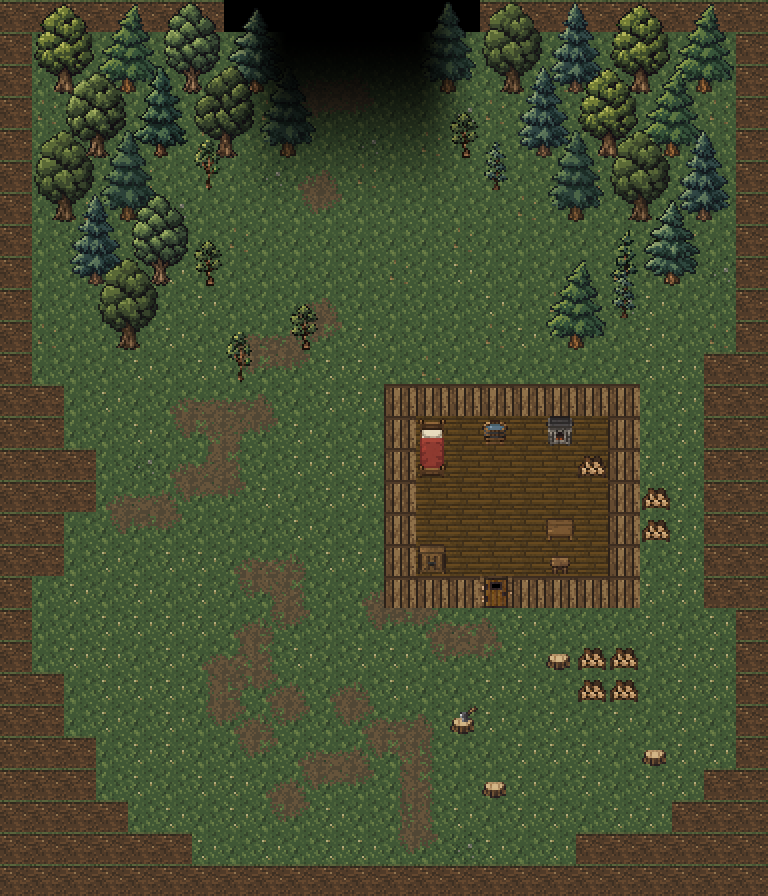

# Лесная локация −1

Создана 2026-11-04 по просьбе Автора на основании иллюстрации сверху.
Планировка обновлена 2026-11-07.
Рабочая подпись в игре — «Лесная тропа»; отдельное собственное название,
новые персонажи и сюжет не утверждались.

Это статическая композиция, собранная без запуска игры. Стены показаны
плоскими тайлами; освещение и туман войны отсутствуют.
[Иллюстрация-референс](woodland-reference.png),
[схема в исходном масштабе](woodland-layout.png),
[скрипт отрисовки](render-woodland.ps1).

## План

Карта уменьшена с 28×40 до 24×28 клеток (672). Вверху густая чаща
обрамляет узкую тропу. Опушка из редких деревьев, саженцев и цветов
переходит в цветочный луг. Примерно от середины его ограничивают земляные
обрывы с выступами по бокам и сужением на юге. Дом в (12, 12) занимает
8×7 клеток вместе со стенами. Южная дверь находится в (15, 18).
Крыши нет: видны кровать, печь, стол с табуретом, шкаф, умывальник и дрова.

Рядом с домом стоят колода с топором (14, 22), три пня и группы поленниц.
Срубленная древесина из референса передана существующим спрайтом дров:
отдельный рисунок лежащего ствола не создавался. Степан остаётся в деревне,
новые NPC, предметные награды и противники не добавлены.

По уточнению Автора от 2026-11-04 вход и выход перенесены на северную
тропу в (10–11, 1–2), связанную с югом Залесья (28–29, 39–40).
При переходе из деревни герой появляется наверху в (10, 4), при возврате —
внизу деревни в (28, 37), отдельно от триггеров. Новая планировка видна при
первом посещении Лесной тропы. Если карта уже создана в сохранении, для
новой планировки потребуется новое прохождение.

## Существующие ресурсы

Первоначальная локация использовала прежние PNG. По следующему указанию
Автора встроенным `image_gen` созданы [земляные обрывы](earth-cliffs.md)
для внешних стен. Домик остаётся деревянным. По последующему уточнению
тропа среди деревьев плавно уходит в темноту под [программным градиентом](passage-fade.md),
без новых игровых текстур. Стена в створе полностью скрыта. Все тропинки
стали слабее и получили ответвления.
Иллюстрация из чата сохранена только как референс документации.

| Ресурс относительно `core/src/main/assets/environment/` | Использование |
| --- | --- |
| `tiles_surface_cliffs.png` | Прежние трава, цветы, листья, камешки, деревянные пол и стены, двери и дорожки; дополнительно — земляные наружные стены. Исходный `tiles_surface.png` сохранён. |
| `custom_tiles/surface_exterior.png` | Дубы, сосны, саженцы и пни. |
| `custom_tiles/surface_furniture.png` | Прозрачные спрайты мебели и поленниц поверх покрытия клетки. |
| `exterior/chopping_block.png` | Существовавшая колода с топором, отдельно от пней Залесья. |

`WoodlandLevel` содержит фиксированный контур обрывов, схему леса и размещение предметов.
`WoodlandFloorTiles` задаёт траекторию тропы и цветочные пятна, без случайных
чисел. `SurfacePathTiles` использует те же готовые переходы к траве,
`SurfaceForest` рисует деревья двумя слоями по переданной схеме.
Общие правила наружных препятствий и мебели — в `OutdoorLevel`.

## Проверка

В статической схеме от 2026-11-07 проверены размеры, проходимость от
точки прибытия к триггеру, дому и лугу, расстановка предметов и прозрачность
семи спрайтов мебели. [Материалы земляных стен и троп](earth-cliffs.md).

После переноса проходов 2026-11-04 обновлены и просмотрены статические схемы
обеих карт, исходники и diff. `:core:compileJava` и `:android:assembleDebug`
успешны. Первая установка прервалась из-за потери соединения. По повторной
просьбе Автора после `adb devices -l` готовый APK установлен обновлением
без пересборки на Wi-Fi планшет с serial
`adb-eb278ce2-Gf1NFr._adb-tls-connect._tcp` (`Success`). Подтверждены
пакет `com.shatteredpixel.shatteredpixeldungeon.indev`, версия `4.0.2-INDEV`
(922) и время обновления `2026-11-04 16:34:58`. Игра и автотесты не запускались.

Проверка первоначальной сборки до переноса проходов:

Просмотрены статическое превью, исходники переходов и загрузки, локализации
и diff. `:core:compileJava` и `:android:assembleDebug` выполнены успешно.
После `adb devices -l` APK установлен обновлением по Wi-Fi ADB на планшет
с serial `adb-eb278ce2-Gf1NFr._adb-tls-connect._tcp` (`Success`).
Подтверждены версия `4.0.2-INDEV` (922), пакет
`com.shatteredpixel.shatteredpixeldungeon.indev` и время обновления
`2026-11-04 16:23:21`. Четыре файла локализации, набор тайлов, два атласа
и PNG колоды в APK совпадают с исходниками по SHA-256.
Игра, автотесты и игровые сценарии не запускались; проверку в игре выполняет Автор.
